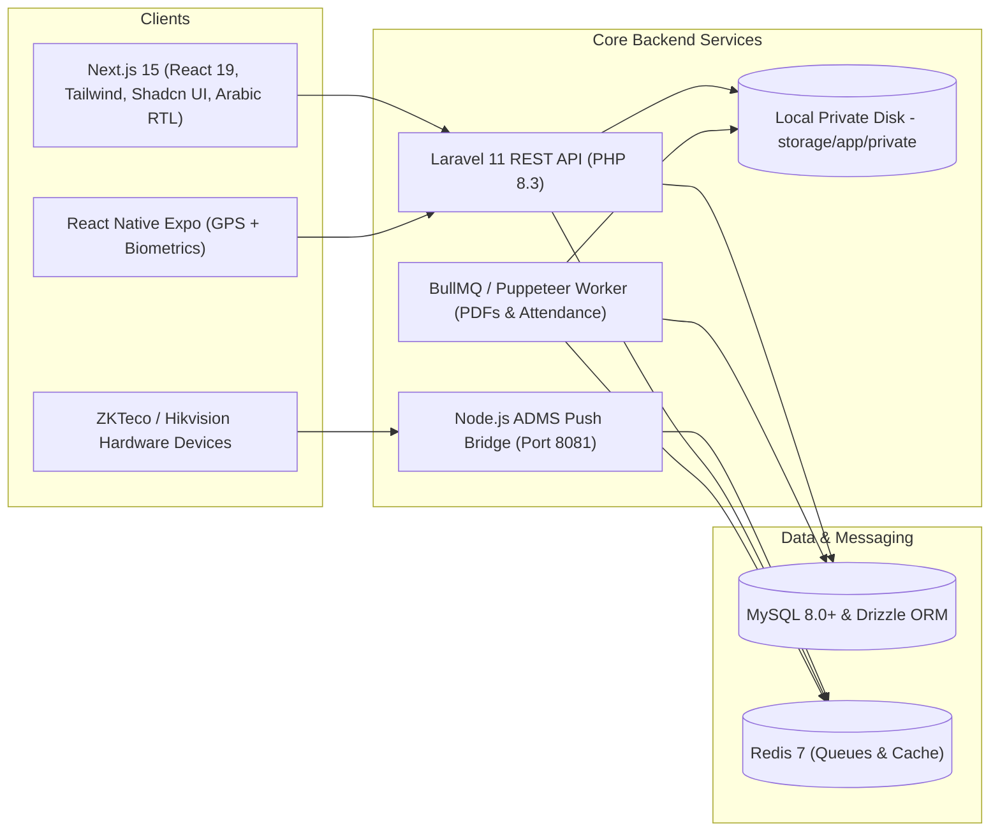

# Enterprise Human Resources Information System (HRIS / HCM)
## Multi-Tenant SaaS Blueprint & Implementation (Egypt & Saudi Arabia / GCC)

Welcome to the architectural, operational, and UI/UX blueprint for the **Enterprise Multi-Tenant HRIS / HCM Platform**. This system is specifically architected for organizations operating in **Egypt** and **Saudi Arabia / GCC**, featuring dual attendance support (Hardware Biometrics + Mobile GPS Geofencing), automated payroll engines, enterprise security, and a full bilingual UI/UX design suite (Arabic RTL & English).

---

## 🛠️ Confirmed Technology Stack

| Layer | Technology | Role |
| :--- | :--- | :--- |
| **Web Frontend** | **Next.js 15 (App Router) + React 19 + Tailwind CSS + Shadcn UI** | Self-service portal for employees, managers, and HR admins with native Arabic RTL. |
| **Mobile App** | **React Native (Expo)** | Mobile clock-in with TouchID/FaceID and GPS geofence boundary checks. |
| **Backend API** | **Laravel 11 (PHP 8.3)** | Core REST API, multi-tenancy scoping, authentication, and regional payroll engines. |
| **Database & ORM** | **MySQL 8.0+ + Drizzle ORM** | Multi-tenant relational schema, type-safe queries, and indexed attendance logs. |
| **Cache & Queues** | **Redis 7 + BullMQ** | High-throughput asynchronous punch processing, PDF generation, and notifications. |
| **Hardware Bridge** | **Node.js HTTP Listener (Fastify)** | Listens for push punches from ZKTeco/Hikvision ADMS devices on port `8081`. |
| **Object Storage** | **Laravel Private Storage** | Local on-server encrypted file storage (`storage/app/private`) streamed securely. |
| **Document Generator** | **Puppeteer (Chromium)** | High-fidelity batch generation of password-protected PDF payslips and contracts. |

---

## 📚 Blueprint Structure & Navigation

| Document | Focus & Scope | Key Contents |
| :--- | :--- | :--- |
| **[01. HR Process Lifecycle](./docs/01_HR_PROCESS_LIFECYCLE_BLUEPRINT.md)** | **Domain & Business Operations** | The 9 pillars of HR (Hire to Retire): ATS, Onboarding, Core HR, Attendance, Payroll, Performance, L&D, Relations, Offboarding. |
| **[02. Functional Specs & Workflows](./docs/02_FUNCTIONAL_SPECIFICATIONS_AND_WORKFLOWS.md)** | **Product & System Logic** | Multi-tenant RBAC permissions matrix (7 roles), Finite State Machines (FSMs), and business rules. |
| **[03. Database Schema (MySQL & Drizzle)](./docs/03_DATABASE_SCHEMA_AND_DATA_MODEL.md)** | **Data Architecture** | MySQL 8.0+ DDL schema + TypeScript Drizzle ORM schema for 30+ tables with multi-tenancy and regional compliance fields. |
| **[04. System Architecture & API Design](./docs/04_SYSTEM_ARCHITECTURE_AND_API_DESIGN.md)** | **Technical Architecture** | Laravel 11 REST API, Node.js ADMS hardware bridge, React Native mobile check-in, local private storage, and BullMQ worker. |
| **[05. Security, Compliance & Audit](./docs/05_SECURITY_COMPLIANCE_AND_AUDIT.md)** | **Governance & Risk** | Field-level encryption (AES-256-GCM), immutable hash-chained audit trails, dual authorization (four-eye principle). |
| **[06. Roadmap & Tech Stack](./docs/06_IMPLEMENTATION_ROADMAP_AND_TECH_STACK.md)** | **Execution & Delivery** | Phased 26-week milestone schedule (from MVP to enterprise scale) tailored to the Laravel + Next.js stack. |
| **[07. Regional Compliance (Egypt & KSA)](./docs/07_REGIONAL_LABOR_COMPLIANCE_EGYPT_AND_SAUDI.md)** | **Statutory Payroll & Laws** | Egyptian Social Insurance Law 148, Income Tax Law 30 (2024 brackets), Saudi GOSI, End of Service Gratuity, and Mudad WPS SIF generator. |
| **[08. UI/UX Design System & Wireframes](./docs/08_UI_UX_DESIGN_SYSTEM_AND_PAGE_SPECIFICATIONS.md)** | **UI/UX & Screen Designs** | Complete wireframes and layout specifications for every page in the system, Arabic RTL design tokens, Cairo/Tajawal typography, and responsive breakpoint rules. |
| **[09. Hardware Biometrics & IoT Bridge](./docs/09_HARDWARE_BIOMETRICS_AND_IOT_INTEGRATION_SPEC.md)** | **IoT & Edge Integration** | ZKTeco ADMS push protocol, Hikvision ISAPI facial terminal integration, network failover buffering, remote device control. |
| **[10. Payroll Engine & Accounting Ledger](./docs/10_PAYROLL_ENGINE_MATHEMATICAL_SPEC_AND_ACCOUNTING_LEDGER.md)** | **Financial Engineering** | Exact mathematical calculation models for Egypt Law 148 / 2024 Tax and Saudi GOSI, double-entry ERP General Ledger posting. |
| **[11. DevOps & Infrastructure](./docs/11_DEPLOYMENT_DEVOPS_AND_INFRASTRUCTURE_ARCHITECTURE.md)** | **Cloud & Production Ops** | Production Docker Compose topology, Nginx SSL reverse proxy, Redis 7 cluster, BullMQ workers, automated PITR backups. |
| **[12. Mobile App & Offline Sync Protocol](./docs/12_EMPLOYEE_SELF_SERVICE_MOBILE_AND_OFFLINE_SYNC_SPEC.md)** | **Mobile & Biometric Security** | React Native Expo architecture, Secure Enclave ECDSA P-256 signing, Anti-GPS mock location heuristics, SQLite offline punch buffer. |
| **[13. Government Integrations & Banking](./docs/13_GOVERNMENT_INTEGRATIONS_AND_BANKING_SPEC.md)** | **Regional Statutory Compliance** | Saudi Mudad WPS SIF 3.0, Qiwa API, GOSI, Muqeem, Egypt ETA e-Payroll (نموذج 4 مرتبات), Social Insurance (س 1, 2, 6), EG-ACH. |

---

## 🖥️ Live Frontend Page Routes (Next.js 15)

All 19 pages are live, fully implemented with Arabic RTL & English support, and verified in the production build:

### Core Operations
- **`/`**: [Cockpit Dashboard](./frontend/src/app/page.tsx) — Quick Clock-in/Out, Attendance geofence radar, Headcount stats, and Statutory Payroll Simulator.
- **`/self-service`**: [Employee Self-Service (ESS)](./frontend/src/app/self-service/page.tsx) — Mobile punch simulator, Salary certificate generator with QR verification, Expense claims, and Salary advance loan requests.
- **`/employees`**: [Employee Directory](./frontend/src/app/employees/page.tsx) — High-density data grid, multi-criteria filters, and 360° employee dossier modal.
- **`/org-chart`**: [Dynamic Org Chart](./frontend/src/app/org-chart/page.tsx) — Interactive hierarchy tree with department nodes, reporting lines, and headcount badges.
- **`/attendance`**: [Attendance & Biometrics Hub](./frontend/src/app/attendance/page.tsx) — Real-time monitoring of ZKTeco and Hikvision ADMS hardware terminals and daily punch sheets.
- **`/shifts`**: [Shift Rostering & Ramadan Rules](./frontend/src/app/shifts/page.tsx) — Weekly department shift matrices, Ramadan statutory 6-hour mode, 15-minute grace period rules, and overtime multipliers.
- **`/leaves`**: [Leave & Absence Management](./frontend/src/app/leaves/page.tsx) — Quota balance pills, sandwich-leave checks, and multi-tier approval queue.
- **`/payroll`**: [Payroll & Compliance Workbench](./frontend/src/app/payroll/page.tsx) — Egyptian Law 148 / 2024 Tax and Saudi GOSI calculation engines, digital payslip PDF preview, and Mudad WPS SIF file export.

### Talent & Growth
- **`/recruitment`**: [Talent Acquisition (ATS)](./frontend/src/app/recruitment/page.tsx) — Visual Kanban candidate pipeline with scorecard ratings (1 to 5).
- **`/performance`**: [Performance, OKRs & 9-Box Matrix](./frontend/src/app/performance/page.tsx) — Interactive 9-Box talent calibration grid and employee OKR objective tracking.
- **`/learning`**: [Learning & Development (L&D)](./frontend/src/app/learning/page.tsx) — Course catalogs, skill badges, mandatory training progress, and certification tracking.

### Governance, Assets & Compliance
- **`/assets`**: [Asset & Custody Tracking](./frontend/src/app/assets/page.tsx) — Company hardware custody logs, serial number tracking, return condition checks, and handover signatures.
- **`/company`**: [Company & Branch Geofencing](./frontend/src/app/company/page.tsx) — Multi-entity profile switcher (Saudi LLC & Egypt S.A.E.), GPS coordinate centroid setups, allowed radius in meters, and Wi-Fi BSSID whitelisting.
- **`/employee-relations`**: [Employee Relations & Grievances](./frontend/src/app/employee-relations/page.tsx) — Confidential grievance filing, impartial investigation case workflows, and disciplinary action logs.
- **`/reports`**: [Executive Analytics & Compliance](./frontend/src/app/reports/page.tsx) — Saudization (Nitaqat) calculator, Egyptianization quota monitoring, Bradford Factor absence risk index.
- **`/offboarding`**: [Offboarding & Clearance](./frontend/src/app/offboarding/page.tsx) — Multi-department checklist (IT, Admin, Finance) and Saudi Labor Law Article 84 & 85 End of Service calculator.
- **`/audit`**: [Cryptographic Audit Trail](./frontend/src/app/audit/page.tsx) — Immutable SHA-256 hash-chained ledger, salary modification diff viewers, PII access logs, and integrity verification.
- **`/settings`**: [Organization & Security](./frontend/src/app/settings/page.tsx) — Company legal profile, WPS bank codes, and interactive RBAC permissions matrix.
- **`/login`**: [Multi-Tenant Login & 2FA](./frontend/src/app/login/page.tsx) — Subdomain tenant auto-detection, SSO buttons (Google / Microsoft), and TOTP 2FA verification dialog.
