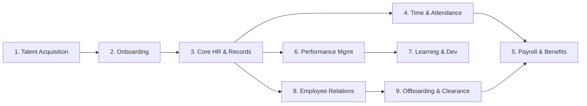
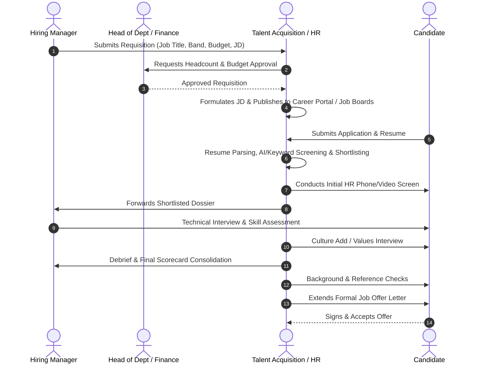
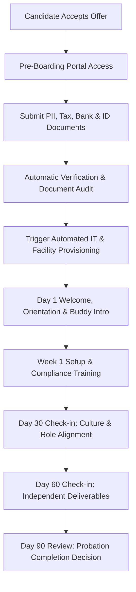
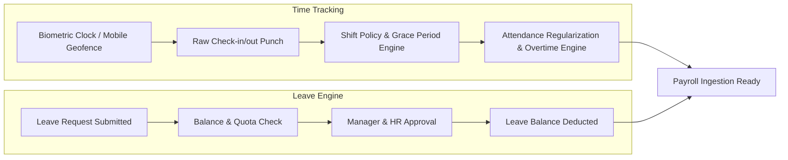
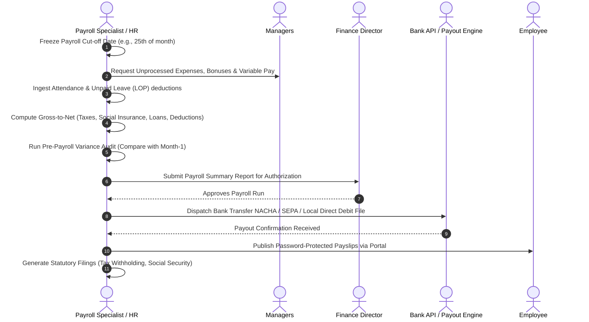
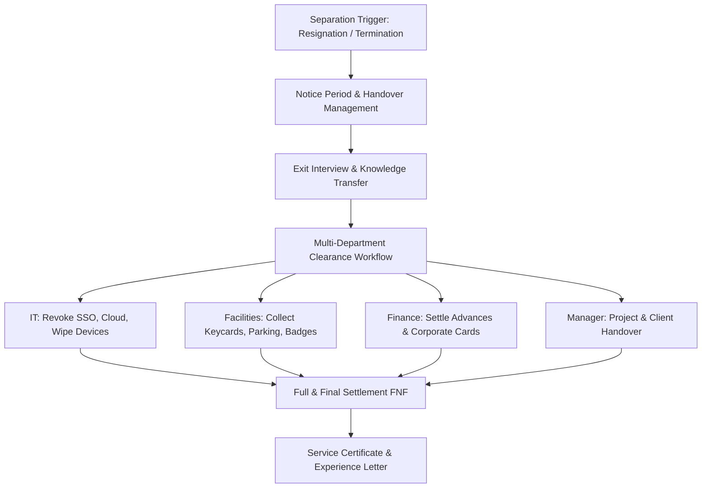

# Phase 01: HR Process Lifecycle Blueprint
## Comprehensive "Hire-to-Retire" Domain Analysis

This document details the operational reality of Human Resources management across organizations of all sizes. It serves as the business domain foundation for designing workflows, data structures, and user experiences in an enterprise HRIS / HCM platform.

---

## 🧭 The 9 Pillars of the HR Lifecycle

---

## Pillar 1: Workforce Planning & Talent Acquisition (Recruitment / ATS)

### 1.1 Objective
Proactively forecast staffing needs, secure approved headcount budgets, attract diverse, qualified candidates, and execute an objective, bias-mitigated hiring process that fills openings with high-caliber talent in a cost-effective timeframe.

### 1.2 Step-by-Step Operational Workflow

#### Step Details:
1. **Headcount Planning & Job Requisition:**
   - Department managers submit hiring requests detailing business justification, proposed salary range, job level, and requested start date.
   - Budget approval gate: Requires sign-off from Department Head, Finance/CFO, and HR Director against the annual headcount plan.
2. **Job Description (JD) Formulation:**
   - Crafting inclusive, gender-neutral, competency-focused job listings.
   - Distinct separation between "Must-Haves" (core technical/functional prerequisites) and "Nice-to-Haves" (transferable skills).
   - Transparent compensation bands (statutorily required in many modern jurisdictions).
3. **Sourcing & Multi-Channel Publishing:**
   - Push to internal job boards (first priority for internal mobility).
   - Push to external portals (LinkedIn, Indeed, specialized boards, university portals, referral links).
4. **Candidate Sourcing & Screening:**
   - Resume parsing into structured candidate records.
   - Pre-screening questionnaires (knockout questions, right-to-work verification).
5. **Structured Assessment & Interviewing:**
   - Standardized interview questions mapped directly to specific role competencies (1 to 5 scoring rubrics).
   - Multi-stage panel: Screening -> Technical/Domain -> Culture/Leadership -> Executive.
   - Debrief calibration: Objective scorecard review to eliminate recency or halo biases.
6. **Pre-Employment Verification:**
   - Reference checks (managerial & peer verification).
   - Background verification (educational diplomas, past employment verification, criminal record checks where legally permissible).
7. **Offer Generation & Negotiation:**
   - Automated offer letter compilation with dynamic tokens (`{{Salary}}`, `{{StockOptions}}`, `{{Benefits}}`, `{{ProbationPeriod}}`, `{{ExpiryDate}}`).
   - Digital signature flow (e-Signature integration).

### 1.3 Key Documents & Artifacts
- **Job Requisition Form (JRF)**
- **Competency-Based Job Description**
- **Structured Interview Kit & Rubrics**
- **Candidate Scorecard**
- **Offer Letter & Employment Agreement**

### 1.4 Critical HR Metrics (KPIs)
- **Time-to-Hire:** Days from requisition approval to candidate acceptance (Target: < 35-45 days).
- **Cost-per-Hire:** Total recruiting expenses (agency fees, advertising, tooling, internal hours) / total hires.
- **Offer Acceptance Rate (OAR):** `(Accepted Offers / Total Offers Extended) * 100` (Benchmark: > 85%).
- **Quality of Hire:** Performance rating of new hire after 6 and 12 months.
- **Source of Hire Efficiency:** Referral vs Inbound vs Direct Outreach ROI.

---

## Pillar 2: Pre-Boarding & Employee Onboarding

### 2.1 Objective
Transform accepted candidates into engaged, productive, and culturally integrated team members through frictionless paperwork, device provisioning, structured training, and clear 30/60/90-day milestone alignment.

### 2.2 Step-by-Step Operational Workflow

#### Step Details:
1. **Pre-Boarding Phase (Offer Acceptance to Day 0):**
   - Self-service portal invitation: Employee uploads personal identification, proof of address, emergency contacts, tax forms, and bank payout details.
   - Digital contract signing: Employee signs NDA, Employee Handbook acknowledgment, and Code of Conduct.
   - IT Asset & Hardware Provisioning: Automated ticket created for Laptop, Monitor, Corporate Email (`@company.com`), SSO access (Google/Azure AD), Slack/Teams, and SaaS licenses.
2. **Day 1: Orientation & Culture Induction:**
   - Welcome session with People Operations (Company vision, core values, policies, organizational structure).
   - Introduction to assigned "Onboarding Buddy" (a peer outside the immediate reporting line).
   - Verification of original physical documents (as required by local labor law).
3. **Week 1: Systems & Team Immersion:**
   - Setting up development/work environment.
   - Mandatory statutory compliance training: Data Privacy/GDPR, Anti-Harassment/DEI, Workplace Safety.
   - Departmental walkthrough and introductory 1-on-1s.
4. **Day 30, 60, 90 Milestone Governance:**
   - **Day 30:** Understanding role scope, tools, initial mini-project completed, early feedback loop with manager.
   - **Day 60:** Autonomous execution, collaboration across cross-functional teams, peer feedback check.
   - **Day 90 (Probation Review):** Comprehensive review between Manager and HR. Outcome: Confirmation of full-time status, extension of probation, or separation.

### 2.3 Key Documents & Artifacts
- **Pre-boarding Document Checklist**
- **Welcome Packet & Employee Handbook**
- **30/60/90-Day Success Plan**
- **IT Hardware Custody Acknowledgement**
- **Probation Confirmation Letter**

### 2.4 Critical HR Metrics (KPIs)
- **Time-to-Productivity:** Weeks until new hire operates at full independent capacity.
- **Onboarding Satisfaction (CSAT/eNPS):** Survey score measured at Day 14 and Day 60.
- **90-Day New Hire Turnover Rate:** Percentage of employees leaving during the probationary period (Target: < 5%).

---

## Pillar 3: Core HR, Organization Hierarchy & Employee Records

### 3.1 Objective
Maintain a centralized, single-source-of-truth repository for all employee master data, organizational structures, job architectures, and historical employment records with strict confidentiality, privacy, and auditability.

### 3.2 Step-by-Step Operational Workflow
1. **Master Profile Administration:**
   - Personal Data: Full name, DOB, nationality, marital status, dependent info, national ID/passport.
   - Employment Data: Employee ID, business unit, department, designation/title, grade/band, cost center, employment type (Full-time, Part-time, Contractor, Intern), hire date, continuous service date.
   - Compensation Metadata: Pay frequency, base currency, overtime eligibility status.
2. **Organizational Structure & Hierarchy:**
   - Dynamic Org Chart rendering: Direct manager, dotted-line manager (matrix reporting), skip-level manager.
   - Department and cost-center mapping with headcounts and budget caps.
   - Position Management: Distinguishing the "Position" (e.g., Senior Backend Engineer #042) from the "Person" holding it.
3. **Employee Self-Service (ESS) & Manager Self-Service (MSS):**
   - ESS: Employees update address, emergency contacts, review payslips, request employment certificates.
   - MSS: Managers view team directory, approve promotions, initiate job changes, view team leaves.
4. **Lifecycle Change Events (Transfers, Promotions, Adjustments):**
   - Initiation of job title change, departmental transfer, promotion, or salary revision.
   - Approval routing through Department Head, HR Business Partner (HRBP), and Finance.
   - Generation of official Promotion/Transfer Addendums.
5. **Secure Document Vault:**
   - Digital archiving of contracts, certificates, disciplinary records, medical notes, performance reviews.
   - Role-based encryption and document expiry alerts (e.g., Visa/work permit expiry, driver's license).

### 3.3 Critical HR Metrics (KPIs)
- **Data Completeness Rate:** % of employee profiles with 100% mandatory fields populated.
- **HR Service SLA Resolution:** Average time taken to fulfill employee requests (letters, profile changes).
- **Headcount Variance:** Actual vs planned headcount per department.

---

## Pillar 4: Time, Attendance, Shift Scheduling & Absence Management

### 4.1 Objective
Accurately capture working hours, manage multi-shift schedules, track attendance compliance, and automate leave accruals and approvals to ensure fair compensation, prevent burnout, and satisfy statutory working hour limits.

### 4.2 Step-by-Step Operational Workflow

#### Step Details:
1. **Shift Planning & Scheduling:**
   - Definition of shift rosters (Regular Day, Night Shift, Split Shift, Rotational 24/7).
   - Rules configuration: Core hours, break windows, flexible arrival windows (e.g., 30-minute grace period).
   - Shift swapping workflows between peers with supervisory sign-off.
2. **Time Capture & Punch Processing:**
   - Physical Biometric Readers (Fingerprint, Facial Recognition, RFID).
   - Mobile Self-Service with GPS Geofencing (for field staff and remote employees).
   - Web punch-in/out via browser with IP whitelisting.
   - Paired In/Out calculation: Automated detection of missing punches, late arrivals, early departures, and unauthorized absences.
3. **Attendance Regularization:**
   - Employee submits regularisation request for missed punches or off-site business duties.
   - Manager reviews context and approves or rejects with reason.
4. **Overtime (OT) Calculation Engine:**
   - Statutory compliance rules: Normal weekday OT (1.25x - 1.5x), Weekend OT (1.5x - 2.0x), Public Holiday OT (2.0x - 3.0x).
   - Pre-approval requirement for planned overtime vs actual clock-recorded overtime.
5. **Leave & Absence Policies (Accrual & Balance):**
   - Leave Types: Annual/Vacation Leave, Casual Leave, Sick/Medical Leave, Maternity/Paternity Leave, Bereavement, Unpaid Leave (LOP/LWP), Compensatory Off (Comp-off).
   - Accrual Models: Monthly upfront, monthly pro-rated, annual lump sum, tenure-based escalation.
   - Carryover & Encashment: Setting maximum carryover days into next fiscal year, lapse policies, cash payout rules upon exit.
   - Absence calendar visibility: Ensuring minimum team coverage before approving overlapping leaves.

### 4.3 Critical HR Metrics (KPIs)
- **Absenteeism Rate:** `(Total Absent Days / Total Available Working Days) * 100`.
- **Bradford Factor:** Formula `S² × D` (where S = number of spells of absence, D = total days absent) to identify disruptive short-term frequent absences.
- **Overtime Ratio:** `(Total Overtime Hours / Total Standard Working Hours) * 100`.
- **Unused Leave Liability:** Financial provision the company carries on its balance sheet for untaken paid leaves.

---

## Pillar 5: Compensation, Benefits & Payroll Processing

### 5.1 Objective
Ensure 100% accurate, timely, and compliant payroll disbursement with zero calculation errors, seamless statutory deductions (taxes, social insurance, pension), transparent payslip delivery, and competitive benefits management.

### 5.2 Step-by-Step Operational Workflow

#### Step Details:
1. **Salary Structure Configuration:**
   - **Earnings:** Basic Salary, Housing Allowance, Transport Allowance, Special Allowances, Bonuses, Commissions, Overtime Pay.
   - **Deductions:** Mandatory Income Tax, Employee Social Insurance/Pension, Health Insurance, Loan/Advance Repayments, Disciplinary Penalties, Loss of Pay (LOP) for unexcused absences.
   - **Employer Contributions:** Employer Pension/Social Security, Group Life/Medical Insurance, Unemployment Fund contributions.
2. **Cut-off & Data Ingestion:**
   - Integration with Time & Attendance module: Ingestion of late cuts, unpaid leaves, approved overtime hours.
   - New joiner pro-rating: Exact calculation from start date for partial months.
   - Leaver pro-rating: Final settlements, notice pay, unconsumed leave encashment, asset recovery deductions.
3. **Gross-to-Net Processing Engine:**
   - Progressive tax bracket calculations based on annual projections or exact monthly brackets according to regional tax law.
   - Application of tax-exempt ceilings, personal tax relief, dependent tax exemptions.
4. **Pre-Payroll Variance Audit & Quality Controls:**
   - Four-eye principle: System compares current month against previous month and flags anomalies (> 10% variance in gross, unexpected additions/deletions).
   - Negative pay check: Ensures total deductions never exceed statutory limits or exceed gross salary.
5. **Approval, Disbursement & Post-Payroll:**
   - Bank Payout file generation (WPS, NACHA, SEPA XML, or custom bank Excel/CSV format).
   - Automated generation of digital, tamper-proof PDF payslips.
   - Generation of General Ledger (GL) journal entries for ERP integration (SAP, Oracle, NetSuite, QuickBooks).

### 5.3 Critical HR Metrics (KPIs)
- **Payroll Accuracy Rate:** `(Error-Free Payslips / Total Payslips Processed) * 100` (Target: > 99.8%).
- **Time to Process Payroll:** Total turnaround days from cut-off to disbursement.
- **Total Cost of Workforce (TCOW):** Total gross payroll + employer taxes + employee benefits + contingent labor costs.

---

## Pillar 6: Performance Management & Talent Development

### 6.1 Objective
Align individual contributions with company strategic objectives, foster continuous feedback and career growth, objectively evaluate achievements, and address underperformance with fair, structured intervention.

### 6.2 Step-by-Step Operational Workflow
1. **Goal Setting & Alignment (OKRs & SMART Goals):**
   - Cascade company goals down to department, team, and individual contributors (ICs).
   - Definition of quantifiable Key Results, milestones, and target deadlines.
2. **Continuous Feedback & 1-on-1 Check-ins:**
   - Bi-weekly or monthly structured check-in agendas documented within the system.
   - Peer praise / recognition ("Kudos") feed for real-time visibility.
3. **Evaluation Cycles (Annual, Semi-Annual, or Quarterly):**
   - **Self-Assessment:** Employee rates themselves on goals and behavioral competencies.
   - **Manager Assessment:** Manager evaluates results and behavioral indicators with concrete examples.
   - **360-Degree Feedback:** Multi-rater reviews from peers, direct reports, and cross-functional partners.
4. **Calibration & Talent Reviews:**
   - Leadership calibration meetings to normalize rating distributions across departments (preventing overly lenient or harsh grading).
   - **9-Box Grid Placement:** Plotting employees along Performance (Past Output) vs Potential (Future Growth).
     - High Potential / High Performance = High Potentials (Succession candidates).
     - Low Performance / High Potential = Coaching candidates.
     - Low Performance / Low Potential = Remediation or exit.
5. **Performance Improvement Plan (PIP) Workflow:**
   - Initiated for sustained underperformance.
   - Formally documented 30 to 60-day action plan with clear, measurable deliverables, bi-weekly check-ins, and explicit consequences.
   - Legal safeguards: Ensures objective records are kept if performance does not improve.

### 6.3 Critical HR Metrics (KPIs)
- **Review Cycle Completion Rate:** % of evaluations finalized by deadline (Target: > 95%).
- **Goal Achievement Rate:** Average % completion of strategic OKRs across the organization.
- **PIP Success Rate:** % of employees on PIP who achieve required performance standards vs exited.
- **High Performer Retention:** Attrition rate among top-tier talent.

---

## Pillar 7: Learning & Development (L&D)

### 7.1 Objective
Close organizational competency gaps, satisfy regulatory compliance certifications, build leadership pipelines, and upskill the workforce to foster career progression and organizational resilience.

### 7.2 Step-by-Step Operational Workflow
1. **Training Needs Analysis (TNA):**
   - Aggregating skill gaps identified during performance appraisals.
   - Identifying statutory mandatory certifications (e.g., ISO, OSHA, Cyber Security, GDPR).
2. **Course Catalog & Learning Management System (LMS):**
   - Host internal courses, videos, SCORM packages, quizzes, and workshops.
   - Integration with external providers (Coursera, Udemy, LinkedIn Learning).
3. **Training Enrollment & Tracking:**
   - Automated assignment based on role, department, or tenure (e.g., new managers assigned "Leadership 101").
   - Deadline tracking with automated reminder escalations to managers.
4. **Certification & Expiry Monitoring:**
   - Upload and validation of credentials. Automated alerts 60/30 days before certification expiration.
5. **Training Evaluation (Kirkpatrick Model):**
   - Level 1: Reaction (Post-course participant survey).
   - Level 2: Learning (Quizzes, assessments, practical tests).
   - Level 3: Behavior (Manager feedback on post-training on-the-job application).
   - Level 4: Results (Business ROI, error reduction, revenue increase).

### 7.3 Critical HR Metrics (KPIs)
- **Mandatory Compliance Training Completion:** Statutorily required to hit 100%.
- **Average Training Hours per Employee:** Annual benchmark (e.g., 20-40 hours/year).
- **Internal Promotion Rate:** % of open managerial/senior roles filled by internally trained employees.

---

## Pillar 8: Employee Relations, Engagement & Workplace Compliance

### 8.1 Objective
Maintain an ethical, safe, inclusive, and legally compliant workplace through clear policies, transparent grievance reporting, thorough and objective workplace investigations, and proactive engagement tracking.

### 8.2 Step-by-Step Operational Workflow
1. **Policy Administration & Acknowledgement:**
   - Central handbook repository with version control.
   - Digital tracking of employee signatures on policy updates (e.g., Remote Work Policy, Code of Ethics).
2. **Grievance Redressal & Whistleblowing:**
   - Secure, confidential (and optional anonymous) reporting channel for harassment, fraud, safety violations, or unfair treatment.
   - Anti-retaliation enforcement protocols.
3. **Formal Investigation Lifecycle:**
   - **Intake:** Logging complaint, assigning confidential case number, assessing conflict of interest.
   - **Investigation Plan:** Identifying witnesses, gathering documentary and digital evidence.
   - **Interviews:** Standardized fact-finding interviews with notes signed by interviewees.
   - **Findings Memo & Determination:** Evaluating evidence under balance-of-probabilities standard.
   - **Remediation & Disciplinary Actions:** Written warning, suspension, mandatory counseling, or termination.
4. **Employee Voice & Engagement (Pulse / eNPS):**
   - Regular anonymous pulse surveys measuring morale, workload, managerial effectiveness.
   - Employee Net Promoter Score (eNPS): "How likely are you to recommend our company as a place to work?"

### 8.3 Critical HR Metrics (KPIs)
- **Employee Net Promoter Score (eNPS):** Calculated as `% Promoters - % Detractors` (Range: -100 to +100).
- **Grievance Resolution Time:** Average days from complaint filing to closure (Target: < 14-21 days).
- **Disciplinary Incident Rate:** Number of formal incidents per 100 employees.

---

## Pillar 9: Offboarding & Separation Management

### 9.1 Objective
Execute professional, dignified, secure, and legally sound separations (voluntary or involuntary) while reclaiming company property, securing IP and digital access, conducting insightful exit analysis, and delivering complete final financial settlements.

### 9.2 Step-by-Step Operational Workflow

#### Step Details:
1. **Separation Notice & Categorization:**
   - **Voluntary:** Resignation submitted via Self-Service with formal reason, proposed last working day (LWD), and notice period check.
   - **Involuntary:** Performance termination, misconduct/summary dismissal, or company redundancy/layoff. Requires documented prior warnings and legal counsel review.
2. **Notice Period Management:**
   - Calculation of contractual notice period vs buy-out requests (waiving notice with financial payment).
   - Handover roadmap: Knowledge transfer sessions, documentation handover, client reassignment.
3. **Exit Interview & Sentiment Capture:**
   - Structured survey: Primary reason for leaving (compensation, manager, lack of growth, company culture, personal).
   - Actionable data aggregated anonymously to detect organizational retention issues.
4. **Departmental Clearance Checklist:**
   - **IT Department:** Immediate revocation of SSO, Google/Microsoft 365, VPN, GitHub/Jira access on Last Working Day at 5:00 PM; physical laptop/equipment return.
   - **Admin/Facilities:** Building access card, keys, company vehicle, parking pass return.
   - **Finance:** Verification that travel advances are cleared and corporate credit cards canceled.
5. **Full & Final Settlement (F&F / FNF):**
   - Calculation of unserved notice compensation, pro-rated last month salary, accrued untaken leave encashment, statutory severance/end-of-service gratuity.
   - Deduction of unreturned equipment value or unpaid company loans.
   - Delivery of payment within the statutory timeline (e.g., within 48 to 72 hours of exit).
6. **Post-Employment Documentation:**
   - Generation of Experience Certificate, Relieving Letter, and tax closing statements.

### 9.3 Critical HR Metrics (KPIs)
- **Annual Turnover Rate:** `(Total Exits in Year / Average Headcount in Year) * 100`.
- **Voluntary vs Involuntary Turnover Split.**
- **Regrettable Attrition Rate:** Percentage of leavers whom the company actively fought to keep.
- **Clearance SLA Completion:** % of final settlements completed on time without legal dispute.

---

## 📊 Summary Matrix: HR Processes vs System Requirements

| HR Process Pillar | Primary Actors | System Data Input | System Deliverable / Output | Core Compliance Risk |
| :--- | :--- | :--- | :--- | :--- |
| **1. Talent Acquisition** | Recruiter, Hiring Manager | Requisitions, Resumes, Rubrics | Candidate Pipeline, Offer Letters | Discrimination, biased screening |
| **2. Onboarding** | New Hire, HR Generalist, IT | Personal PII, Tax, IDs | Provisioned Accounts, 30/60/90 Plans | Incomplete legal right-to-work |
| **3. Core HR** | HR Admin, Employee | Demographic & Contract Data | Org Chart, Master Directory | PII exposure, outdated reporting lines |
| **4. Time & Attendance** | Employee, Shift Supervisor | Biometric Punches, Leave Requests | Timesheets, Overtime Logs, Balances | Working time directive violations |
| **5. Payroll & Benefits** | Payroll Specialist, Finance | Attendance cuts, Salary rules | Bank Files, Encrypted Payslips, Tax Filings | Calculation errors, statutory fines |
| **6. Performance** | Manager, Employee, HRBP | Goals/OKRs, 360 Feedback | Rating Matrix, 9-Box, PIPs | Unjust dismissal litigation |
| **7. Learning & Dev** | L&D Manager, Employee | Course Catalogs, Enrollments | Transcripts, Certificate Expirations | Expired mandatory safety licenses |
| **8. Employee Relations** | HR Director, Investigator | Grievances, Investigation Notes | Findings Memo, Incident Logs | Retaliation claims, toxic culture |
| **9. Offboarding** | Manager, IT, HR, Finance | Resignation, Asset Inventory | FNF Settlement, Experience Letter | Data leakage, unpaid end-of-service |

