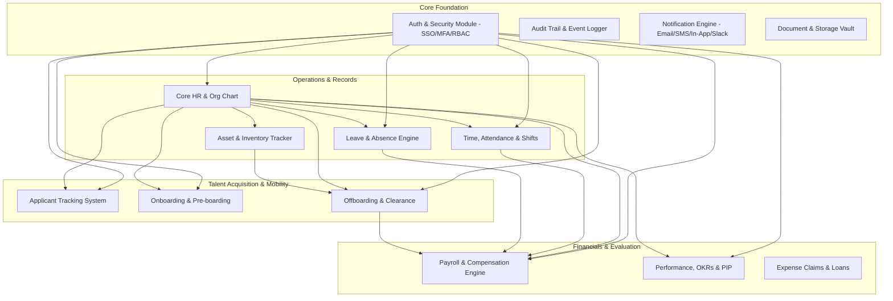
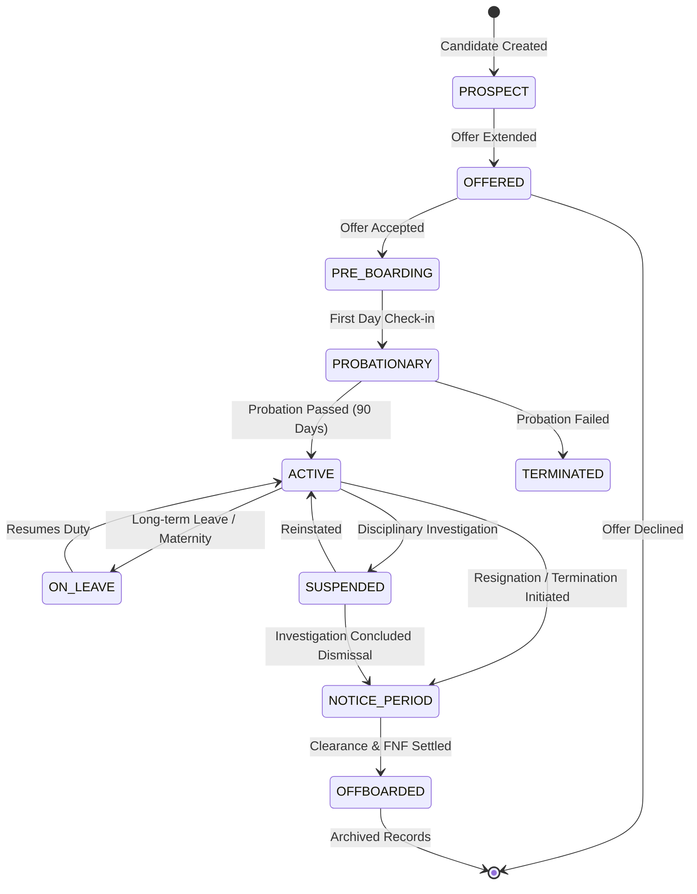
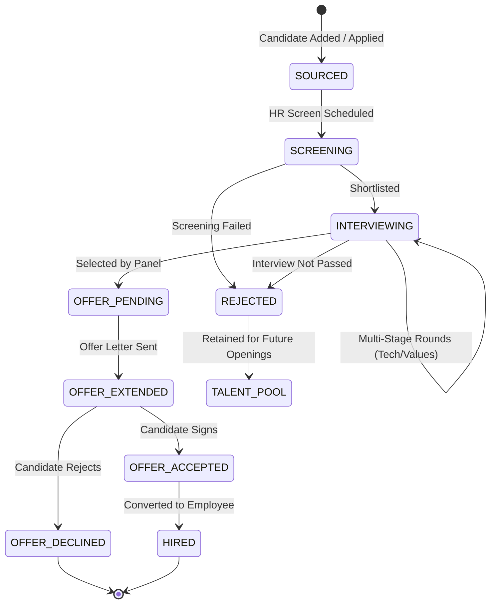
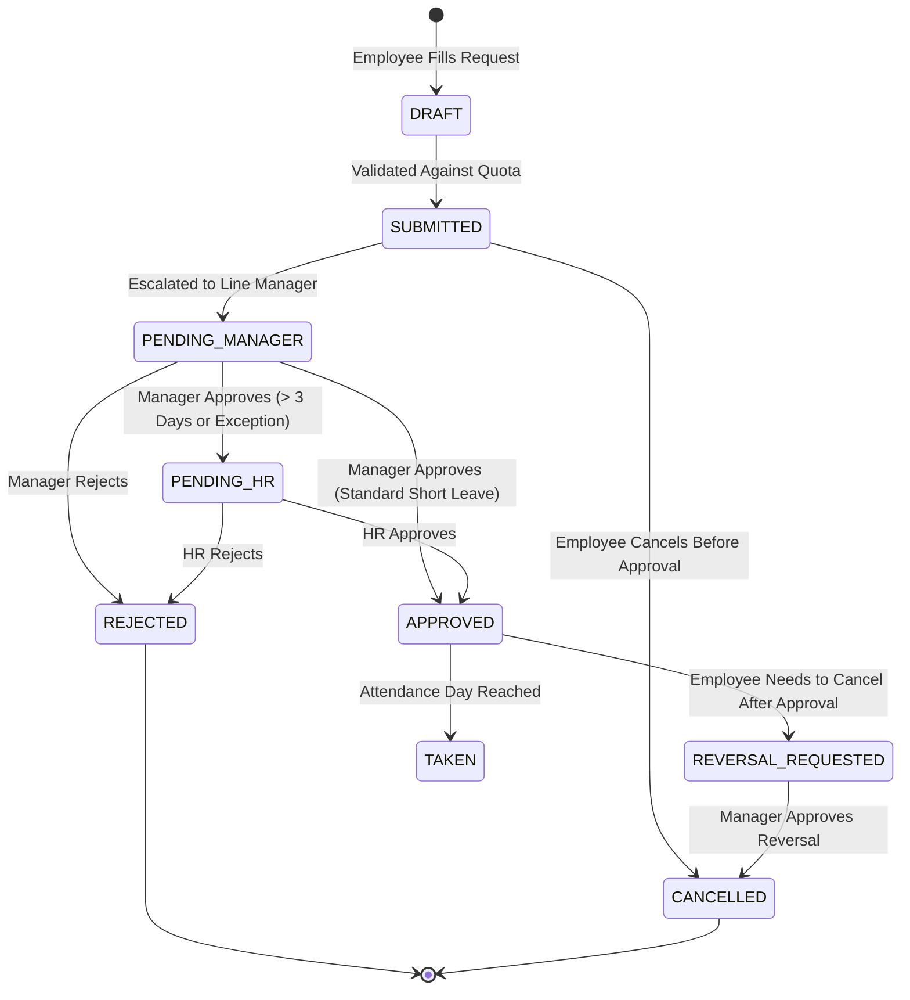
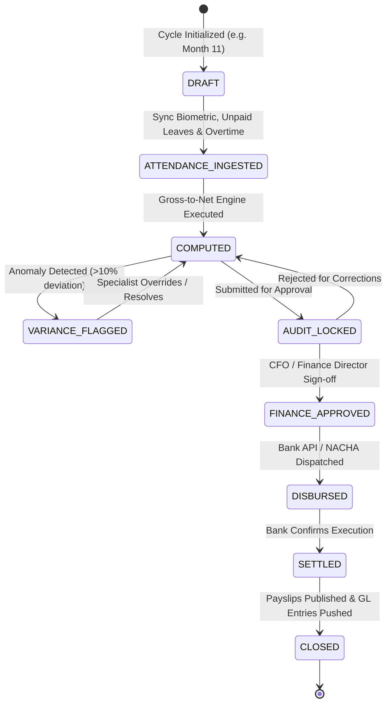
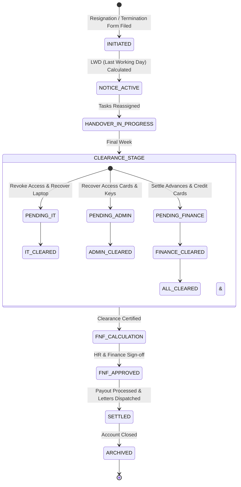

# Phase 02: Functional Specifications & Workflows
## System Architecture, RBAC, State Machines & Business Logic

This document translates the operational HR domain into functional system requirements, modular specifications, role-based security matrices, finite state machines (FSMs), and business logic algorithms.

---

## 🧩 System Module Architecture



---

## 👥 Role-Based Access Control (RBAC) Matrix

The system enforces granular Role-Based Access Control at the API and UI levels:

| Role Name | Code | Description & Scope |
| :--- | :--- | :--- |
| **Super Admin** | `SUPER_ADMIN` | Full system control, tenant configurations, integrations, system logs. |
| **HR Director** | `HR_DIRECTOR` | Global organizational visibility, approval authority across all HR modules, policy settings. |
| **HR Executive / Specialist** | `HR_EXEC` | Day-to-day HR operations: candidate management, onboarding, leaves, attendance edits, record updates. |
| **Payroll Officer** | `PAYROLL_OFFICER` | Read access to employee master data & attendance; full control over salary structures, payroll runs, bank disbursements. |
| **Department Manager / Lead** | `DEPT_MANAGER` | Scope restricted to direct and indirect reports (departmental hierarchy). Approves leaves, overtimes, reviews. |
| **Employee (Self-Service)** | `EMPLOYEE` | Restricted strictly to own personal records, attendance, payslips, leave requests, and company directory. |
| **Compliance Auditor** | `AUDITOR` | Read-only access to historical logs, policies, compliance trainings, and anonymized reports. |

### Granular Permissions Grid

| Resource / Module | Action | Super Admin | HR Director | HR Exec | Payroll Officer | Dept Manager | Employee | Auditor |
| :--- | :--- | :---: | :---: | :---: | :---: | :---: | :---: | :---: |
| **Employee PII** | Create/Update | ✅ | ✅ | ✅ | ❌ | ❌ | Self (Limited) | ❌ |
| **Employee Salary** | View/Edit | ✅ | ✅ | ❌ | ✅ | ❌ | Self (View Only) | ❌ |
| **Job Openings** | Publish | ✅ | ✅ | ✅ | ❌ | Request Only | ❌ | ❌ |
| **Candidate Resumes** | View/Score | ✅ | ✅ | ✅ | ❌ | Assigned Only | ❌ | ❌ |
| **Attendance Punches** | Regularize | ✅ | ✅ | ✅ | ❌ | Direct Reports | Self (Request) | View Only |
| **Leave Requests** | Approve | ✅ | ✅ | ✅ | ❌ | Direct Reports | Self (Request) | View Only |
| **Payroll Execution** | Run & Finalize | ✅ | Sign-off | ❌ | Execute | ❌ | ❌ | View Only |
| **Performance Reviews** | Complete | ✅ | Calibrate | Monitor | ❌ | Direct Reports | Self Review | ❌ |
| **System Audit Logs** | View | ✅ | ✅ | ❌ | ❌ | ❌ | ❌ | ✅ |

---

## 🔄 Core Finite State Machines (FSMs)

### 1. Employee Lifecycle State Machine

An employee's state determines access rights, payroll eligibility, and automated notifications:



### 2. Recruitment & Candidate Pipeline FSM



### 3. Leave & Absence Request FSM



### 4. Payroll Run State Machine



### 5. Offboarding & Full & Final (FNF) Clearance FSM



---

## ⚙️ Core Business Logic & Algorithms

### 1. Pro-Rated Leave Accrual Algorithm

Leave quotas must be calculated accurately based on join date, policy type, and frequency.

```typescript
interface AccrualInput {
  employeeJoinDate: Date;
  fiscalYearStart: Date;
  fiscalYearEnd: Date;
  annualEntitlement: number; // e.g., 21 days
  accrualFrequency: 'ANNUAL_LUMP_SUM' | 'MONTHLY_PRORATED';
  probationMonths: number;
}

function calculateAccrual(input: AccrualInput, currentDate: Date): number {
  if (input.accrualFrequency === 'ANNUAL_LUMP_SUM') {
    // If joined before fiscal year start, grant full
    if (input.employeeJoinDate <= input.fiscalYearStart) {
      return input.annualEntitlement;
    }
    // Pro-rate remaining months in current fiscal year
    const totalMonthsInYear = 12;
    const monthsRemaining = Math.max(
      0,
      12 - input.employeeJoinDate.getMonth()
    );
    return Math.round((input.annualEntitlement / totalMonthsInYear) * monthsRemaining * 10) / 10;
  }

  // Monthly accrual: 1.75 days per completed month (21 / 12)
  const monthlyRate = input.annualEntitlement / 12;
  const startEffective = input.employeeJoinDate > input.fiscalYearStart ? input.employeeJoinDate : input.fiscalYearStart;
  
  const completedMonths = Math.max(
    0,
    (currentDate.getFullYear() - startEffective.getFullYear()) * 12 + 
    (currentDate.getMonth() - startEffective.getMonth())
  );
  
  return Math.min(input.annualEntitlement, Math.round(completedMonths * monthlyRate * 100) / 100);
}
```

### 2. Overtime & Late Penalty Business Logic

```typescript
interface AttendanceRecord {
  shiftStartTime: string; // "09:00"
  shiftEndTime: string;   // "17:00"
  clockInTime: string;    // "09:35"
  clockOutTime: string;   // "19:30"
  gracePeriodMinutes: number; // 15 mins
  isWeekendOrHoliday: boolean;
}

interface AttendanceCalculationResult {
  isLate: boolean;
  lateMinutes: number;
  regularHoursWorked: number;
  overtimeHours: number;
  overtimeMultiplier: number; // 1.5x or 2.0x
}

function processAttendancePunch(record: AttendanceRecord): AttendanceCalculationResult {
  const shiftStart = parseTimeToMinutes(record.shiftStartTime);
  const shiftEnd = parseTimeToMinutes(record.shiftEndTime);
  const clockIn = parseTimeToMinutes(record.clockInTime);
  const clockOut = parseTimeToMinutes(record.clockOutTime);

  // Late calculation with grace period
  const lateMinutes = Math.max(0, clockIn - (shiftStart + record.gracePeriodMinutes));
  const isLate = lateMinutes > 0;

  // Working hours
  const actualWorkedMinutes = Math.max(0, clockOut - clockIn);
  const scheduledMinutes = shiftEnd - shiftStart;

  // Overtime
  let overtimeMinutes = 0;
  let multiplier = 1.5;

  if (record.isWeekendOrHoliday) {
    overtimeMinutes = actualWorkedMinutes;
    multiplier = 2.0; // Weekend/Holiday premium rate
  } else if (clockOut > shiftEnd) {
    overtimeMinutes = clockOut - shiftEnd;
  }

  return {
    isLate,
    lateMinutes,
    regularHoursWorked: Math.min(scheduledMinutes, actualWorkedMinutes) / 60,
    overtimeHours: Math.round((overtimeMinutes / 60) * 100) / 100,
    overtimeMultiplier: multiplier
  };
}
```

### 3. Gross-to-Net Payroll Formula

$$\text{Net Salary} = \text{Gross Salary} - (\text{Statutory Income Tax} + \text{Employee Social Insurance} + \text{Employee Pension} + \text{Unpaid Leave / LOP} + \text{Penalties / Loans}) + \text{Reimbursements}$$

Where:
$$\text{Gross Salary} = \text{Base Salary} + \text{Housing Allowance} + \text{Transportation Allowance} + \text{Other Allowances} + \text{Overtime Pay} + \text{Performance Bonus}$$

$$\text{Loss of Pay (LOP Deductions)} = \frac{\text{Base Salary} + \text{Fixed Allowances}}{\text{Days in Month}} \times \text{Unexcused Absent Days}$$

### 4. Full & Final Settlement (FNF) Encashment Calculation

$$\text{Leave Encashment Payout} = \frac{\text{Monthly Base Salary}}{30} \times \text{Unused Approved Leave Balance}$$

$$\text{End of Service Gratuity / Severance} = f(\text{Tenure Years}, \text{Separation Type}, \text{Final Base Salary})$$

*(Computed according to statutory country-specific multipliers, e.g. 15 days pay per year for first 5 years, 30 days pay per year thereafter).*

---

## ⚠️ Critical Edge Cases & System Constraints

1. **Sandwich Leave Policy (Configurable per Tenant):**
   - If an employee takes Friday and Monday off, and Saturday/Sunday are weekly off-days, some labor policies treat the weekend as leave days (4 days deducted instead of 2). The system must support a policy toggle `deduct_sandwich_holidays = true/false`.
2. **Negative Net Salary Prevention:**
   - In instances where an employee has excessive loan repayments, unpaid leave, and disciplinary deductions, deductions could exceed gross pay. The system enforces a **Statutory Deduction Cap** (e.g., maximum 50% of gross salary can be deducted in any single pay cycle; excess is carried forward to subsequent cycles).
3. **Mid-Month Salary Structure Changes:**
   - If an employee receives a promotion on the 18th of the month, the payroll engine must support split pro-rating (17 days on Old Band + 13 days on New Band).
4. **Biometric Clock Out-of-Sequence Punches:**
   - Employees checking in multiple times in an hour or forgetting to punch out. The system features an automated punch-pairing algorithm that uses the earliest punch as Check-In and latest punch as Check-Out, flagging mid-day anomalies for regularization.

