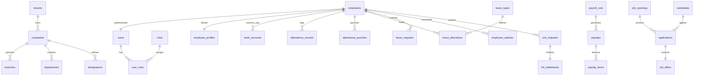

# Phase 03: Database Schema & Data Model
## MySQL 8.0+ DDL & TypeScript Drizzle ORM Schema (Multi-Tenant SaaS)

This document provides the complete, production-grade **MySQL 8.0+ relational schema** and the corresponding **TypeScript Drizzle ORM** definition (`drizzle-orm/mysql-core`).

It is customized for **Multi-Tenant SaaS** isolation and contains the statutory fields required for **Egypt** and **Saudi Arabia / GCC** labor laws.

---

## 🏛️ Entity-Relationship Topology



---

## 🗄️ MySQL 8.0+ DDL Schema

```sql
-- Character Set & Collation Setup
-- Database: hrsystem_db
-- Engine: InnoDB, Charset: utf8mb4, Collation: utf8mb4_0900_ai_ci

SET FOREIGN_KEY_CHECKS = 0;

-- 1. Multi-Tenant Master Table
CREATE TABLE IF NOT EXISTS tenants (
    id CHAR(36) NOT NULL PRIMARY KEY,
    name VARCHAR(150) NOT NULL,
    subdomain VARCHAR(63) NOT NULL UNIQUE,
    subscription_plan ENUM('STARTER', 'GROWTH', 'ENTERPRISE') NOT NULL DEFAULT 'ENTERPRISE',
    country_jurisdiction ENUM('EGYPT', 'SAUDI_ARABIA', 'GCC_OTHER', 'GLOBAL') NOT NULL DEFAULT 'EGYPT',
    is_active BOOLEAN NOT NULL DEFAULT TRUE,
    created_at TIMESTAMP NOT NULL DEFAULT CURRENT_TIMESTAMP,
    updated_at TIMESTAMP NOT NULL DEFAULT CURRENT_TIMESTAMP ON UPDATE CURRENT_TIMESTAMP,
    INDEX idx_tenants_subdomain (subdomain)
) ENGINE=InnoDB DEFAULT CHARSET=utf8mb4 COLLATE=utf8mb4_0900_ai_ci;

-- 2. Companies / Legal Entities
CREATE TABLE IF NOT EXISTS companies (
    id CHAR(36) NOT NULL PRIMARY KEY,
    tenant_id CHAR(36) NOT NULL,
    legal_name VARCHAR(200) NOT NULL,
    trade_name VARCHAR(150),
    commercial_registration_no VARCHAR(50), -- CR Number / السجل التجاري
    tax_registration_no VARCHAR(50),        -- البطاقة الضريبية / VAT Number
    social_insurance_no VARCHAR(50),       -- الرقم التأميني للمنشأة (Egypt / GOSI)
    wps_employer_id VARCHAR(50),           -- Ministry of Human Resources / Qiwa / WPS ID
    bank_code VARCHAR(20),                 -- Bank identifier for WPS SIF file
    primary_iban VARCHAR(34),
    country_code CHAR(3) NOT NULL,         -- 'EGY', 'SAU', etc.
    currency CHAR(3) NOT NULL DEFAULT 'USD',
    created_at TIMESTAMP NOT NULL DEFAULT CURRENT_TIMESTAMP,
    updated_at TIMESTAMP NOT NULL DEFAULT CURRENT_TIMESTAMP ON UPDATE CURRENT_TIMESTAMP,
    CONSTRAINT fk_companies_tenant FOREIGN KEY (tenant_id) REFERENCES tenants(id) ON DELETE CASCADE,
    INDEX idx_companies_tenant (tenant_id)
) ENGINE=InnoDB DEFAULT CHARSET=utf8mb4 COLLATE=utf8mb4_0900_ai_ci;

-- 3. Branches / Physical Locations
CREATE TABLE IF NOT EXISTS branches (
    id CHAR(36) NOT NULL PRIMARY KEY,
    tenant_id CHAR(36) NOT NULL,
    company_id CHAR(36) NOT NULL,
    name VARCHAR(100) NOT NULL,
    address_line VARCHAR(255) NOT NULL,
    city VARCHAR(100) NOT NULL,
    timezone VARCHAR(50) NOT NULL DEFAULT 'Africa/Cairo',
    geofence_latitude DECIMAL(10, 8),
    geofence_longitude DECIMAL(11, 8),
    geofence_radius_meters INT DEFAULT 200,
    attendance_mode ENUM('BIOMETRIC_ONLY', 'MOBILE_GEOFENCE_ONLY', 'BOTH', 'ANY') NOT NULL DEFAULT 'BOTH',
    created_at TIMESTAMP NOT NULL DEFAULT CURRENT_TIMESTAMP,
    CONSTRAINT fk_branches_tenant FOREIGN KEY (tenant_id) REFERENCES tenants(id) ON DELETE CASCADE,
    CONSTRAINT fk_branches_company FOREIGN KEY (company_id) REFERENCES companies(id) ON DELETE CASCADE,
    INDEX idx_branches_tenant_comp (tenant_id, company_id)
) ENGINE=InnoDB DEFAULT CHARSET=utf8mb4 COLLATE=utf8mb4_0900_ai_ci;

-- 4. Departments
CREATE TABLE IF NOT EXISTS departments (
    id CHAR(36) NOT NULL PRIMARY KEY,
    tenant_id CHAR(36) NOT NULL,
    company_id CHAR(36) NOT NULL,
    parent_id CHAR(36) NULL,
    name VARCHAR(100) NOT NULL,
    code VARCHAR(30) NOT NULL,
    cost_center_code VARCHAR(50),
    manager_employee_id CHAR(36) NULL,
    created_at TIMESTAMP NOT NULL DEFAULT CURRENT_TIMESTAMP,
    CONSTRAINT fk_depts_tenant FOREIGN KEY (tenant_id) REFERENCES tenants(id) ON DELETE CASCADE,
    CONSTRAINT fk_depts_company FOREIGN KEY (company_id) REFERENCES companies(id) ON DELETE CASCADE,
    CONSTRAINT fk_depts_parent FOREIGN KEY (parent_id) REFERENCES departments(id) ON DELETE SET NULL,
    UNIQUE KEY uk_tenant_dept_code (tenant_id, company_id, code)
) ENGINE=InnoDB DEFAULT CHARSET=utf8mb4 COLLATE=utf8mb4_0900_ai_ci;

-- 5. Designations / Job Titles
CREATE TABLE IF NOT EXISTS designations (
    id CHAR(36) NOT NULL PRIMARY KEY,
    tenant_id CHAR(36) NOT NULL,
    title VARCHAR(100) NOT NULL,
    job_level VARCHAR(20) NOT NULL,
    grade VARCHAR(20),
    min_salary DECIMAL(14, 2),
    max_salary DECIMAL(14, 2),
    created_at TIMESTAMP NOT NULL DEFAULT CURRENT_TIMESTAMP,
    CONSTRAINT fk_desig_tenant FOREIGN KEY (tenant_id) REFERENCES tenants(id) ON DELETE CASCADE
) ENGINE=InnoDB DEFAULT CHARSET=utf8mb4 COLLATE=utf8mb4_0900_ai_ci;

-- 6. Application Users (Identity)
CREATE TABLE IF NOT EXISTS users (
    id CHAR(36) NOT NULL PRIMARY KEY,
    tenant_id CHAR(36) NOT NULL,
    email VARCHAR(191) NOT NULL,
    password_hash VARCHAR(255) NOT NULL,
    two_factor_secret VARCHAR(255) NULL,
    is_two_factor_enabled BOOLEAN NOT NULL DEFAULT FALSE,
    status ENUM('ACTIVE', 'SUSPENDED', 'INVITED') NOT NULL DEFAULT 'ACTIVE',
    last_login_at TIMESTAMP NULL,
    created_at TIMESTAMP NOT NULL DEFAULT CURRENT_TIMESTAMP,
    updated_at TIMESTAMP NOT NULL DEFAULT CURRENT_TIMESTAMP ON UPDATE CURRENT_TIMESTAMP,
    CONSTRAINT fk_users_tenant FOREIGN KEY (tenant_id) REFERENCES tenants(id) ON DELETE CASCADE,
    UNIQUE KEY uk_tenant_user_email (tenant_id, email)
) ENGINE=InnoDB DEFAULT CHARSET=utf8mb4 COLLATE=utf8mb4_0900_ai_ci;

-- 7. Roles & RBAC
CREATE TABLE IF NOT EXISTS roles (
    id CHAR(36) NOT NULL PRIMARY KEY,
    tenant_id CHAR(36) NOT NULL,
    code VARCHAR(50) NOT NULL,
    name VARCHAR(100) NOT NULL,
    description TEXT,
    created_at TIMESTAMP NOT NULL DEFAULT CURRENT_TIMESTAMP,
    CONSTRAINT fk_roles_tenant FOREIGN KEY (tenant_id) REFERENCES tenants(id) ON DELETE CASCADE,
    UNIQUE KEY uk_tenant_role_code (tenant_id, code)
) ENGINE=InnoDB DEFAULT CHARSET=utf8mb4 COLLATE=utf8mb4_0900_ai_ci;

CREATE TABLE IF NOT EXISTS user_roles (
    user_id CHAR(36) NOT NULL,
    role_id CHAR(36) NOT NULL,
    PRIMARY KEY (user_id, role_id),
    CONSTRAINT fk_ur_user FOREIGN KEY (user_id) REFERENCES users(id) ON DELETE CASCADE,
    CONSTRAINT fk_ur_role FOREIGN KEY (role_id) REFERENCES roles(id) ON DELETE CASCADE
) ENGINE=InnoDB DEFAULT CHARSET=utf8mb4 COLLATE=utf8mb4_0900_ai_ci;

-- 8. Employees Master Table
CREATE TABLE IF NOT EXISTS employees (
    id CHAR(36) NOT NULL PRIMARY KEY,
    tenant_id CHAR(36) NOT NULL,
    company_id CHAR(36) NOT NULL,
    branch_id CHAR(36) NULL,
    department_id CHAR(36) NULL,
    designation_id CHAR(36) NULL,
    user_id CHAR(36) NULL UNIQUE,
    manager_id CHAR(36) NULL,
    
    employee_number VARCHAR(50) NOT NULL,
    first_name VARCHAR(100) NOT NULL,
    middle_name VARCHAR(100) NULL,
    last_name VARCHAR(100) NOT NULL,
    work_email VARCHAR(191) NOT NULL,
    phone_number VARCHAR(30) NULL,
    
    hire_date DATE NOT NULL,
    probation_end_date DATE NULL,
    confirmation_date DATE NULL,
    separation_date DATE NULL,
    
    is_national BOOLEAN NOT NULL DEFAULT TRUE, -- Citizen (Egyptian/Saudi) vs Expat
    allowed_attendance_mode ENUM('DEFAULT', 'BIOMETRIC_ONLY', 'MOBILE_GEOFENCE_ONLY', 'BOTH') NOT NULL DEFAULT 'DEFAULT',
    biometric_device_user_id VARCHAR(50) NULL, -- ID mapped in ZKTeco/Hikvision machine
    
    employment_type ENUM('FULL_TIME', 'PART_TIME', 'CONTRACTOR', 'INTERN') NOT NULL DEFAULT 'FULL_TIME',
    employment_status ENUM('PROSPECT', 'ONBOARDING', 'PROBATIONARY', 'ACTIVE', 'ON_LEAVE', 'SUSPENDED', 'NOTICE_PERIOD', 'OFFBOARDED') NOT NULL DEFAULT 'PROBATIONARY',
    
    created_at TIMESTAMP NOT NULL DEFAULT CURRENT_TIMESTAMP,
    updated_at TIMESTAMP NOT NULL DEFAULT CURRENT_TIMESTAMP ON UPDATE CURRENT_TIMESTAMP,
    
    CONSTRAINT fk_emp_tenant FOREIGN KEY (tenant_id) REFERENCES tenants(id) ON DELETE CASCADE,
    CONSTRAINT fk_emp_company FOREIGN KEY (company_id) REFERENCES companies(id) ON DELETE RESTRICT,
    CONSTRAINT fk_emp_branch FOREIGN KEY (branch_id) REFERENCES branches(id) ON DELETE SET NULL,
    CONSTRAINT fk_emp_dept FOREIGN KEY (department_id) REFERENCES departments(id) ON DELETE SET NULL,
    CONSTRAINT fk_emp_desig FOREIGN KEY (designation_id) REFERENCES designations(id) ON DELETE SET NULL,
    CONSTRAINT fk_emp_user FOREIGN KEY (user_id) REFERENCES users(id) ON DELETE SET NULL,
    CONSTRAINT fk_emp_manager FOREIGN KEY (manager_id) REFERENCES employees(id) ON DELETE SET NULL,
    UNIQUE KEY uk_tenant_emp_no (tenant_id, employee_number),
    UNIQUE KEY uk_tenant_work_email (tenant_id, work_email),
    INDEX idx_emp_biometric_uid (tenant_id, biometric_device_user_id)
) ENGINE=InnoDB DEFAULT CHARSET=utf8mb4 COLLATE=utf8mb4_0900_ai_ci;

-- 9. Sensitive Employee Profile (Encrypted PII & Regional Compliance)
CREATE TABLE IF NOT EXISTS employee_profiles (
    employee_id CHAR(36) NOT NULL PRIMARY KEY,
    national_id_encrypted VARCHAR(255) NOT NULL, -- Egyptian National ID or Saudi National ID
    iqama_number_encrypted VARCHAR(255) NULL,   -- Expat Residency Permit (Saudi Muqeem / Egypt Residency)
    iqama_expiry_date DATE NULL,                -- Expiry date for proactive alerts
    passport_number_encrypted VARCHAR(255) NULL,
    social_insurance_no VARCHAR(50) NULL,       -- Egypt Insurance No or Saudi GOSI Contributor No
    date_of_birth DATE NOT NULL,
    gender ENUM('MALE', 'FEMALE') NOT NULL,
    nationality CHAR(3) NOT NULL,               -- ISO 3166-1 alpha-3
    marital_status VARCHAR(20) DEFAULT 'SINGLE',
    residential_address TEXT,
    created_at TIMESTAMP NOT NULL DEFAULT CURRENT_TIMESTAMP,
    updated_at TIMESTAMP NOT NULL DEFAULT CURRENT_TIMESTAMP ON UPDATE CURRENT_TIMESTAMP,
    CONSTRAINT fk_ep_employee FOREIGN KEY (employee_id) REFERENCES employees(id) ON DELETE CASCADE,
    INDEX idx_iqama_expiry (iqama_expiry_date)
) ENGINE=InnoDB DEFAULT CHARSET=utf8mb4 COLLATE=utf8mb4_0900_ai_ci;

-- 10. Bank Accounts (WPS & Payout)
CREATE TABLE IF NOT EXISTS bank_accounts (
    id CHAR(36) NOT NULL PRIMARY KEY,
    employee_id CHAR(36) NOT NULL,
    bank_name VARCHAR(100) NOT NULL,
    bank_routing_code VARCHAR(20) NOT NULL, -- Bank Identifier (e.g., Al Rajhi: RJHI, NBE: NBEG)
    iban_encrypted VARCHAR(255) NOT NULL,
    account_number_encrypted VARCHAR(255) NOT NULL,
    is_primary BOOLEAN NOT NULL DEFAULT TRUE,
    created_at TIMESTAMP NOT NULL DEFAULT CURRENT_TIMESTAMP,
    CONSTRAINT fk_ba_employee FOREIGN KEY (employee_id) REFERENCES employees(id) ON DELETE CASCADE
) ENGINE=InnoDB DEFAULT CHARSET=utf8mb4 COLLATE=utf8mb4_0900_ai_ci;

-- 11. Work Shifts & Attendance Records
CREATE TABLE IF NOT EXISTS shifts (
    id CHAR(36) NOT NULL PRIMARY KEY,
    tenant_id CHAR(36) NOT NULL,
    name VARCHAR(100) NOT NULL,
    start_time TIME NOT NULL,
    end_time TIME NOT NULL,
    grace_period_minutes INT NOT NULL DEFAULT 15,
    half_day_hours DECIMAL(4, 2) NOT NULL DEFAULT 4.00,
    full_day_hours DECIMAL(4, 2) NOT NULL DEFAULT 8.00,
    is_ramadan_reduced BOOLEAN NOT NULL DEFAULT FALSE, -- KSA 6-hour Ramadan rule
    created_at TIMESTAMP NOT NULL DEFAULT CURRENT_TIMESTAMP,
    CONSTRAINT fk_shifts_tenant FOREIGN KEY (tenant_id) REFERENCES tenants(id) ON DELETE CASCADE
) ENGINE=InnoDB DEFAULT CHARSET=utf8mb4 COLLATE=utf8mb4_0900_ai_ci;

CREATE TABLE IF NOT EXISTS attendance_records (
    id CHAR(36) NOT NULL PRIMARY KEY,
    tenant_id CHAR(36) NOT NULL,
    employee_id CHAR(36) NOT NULL,
    date DATE NOT NULL,
    shift_id CHAR(36) NULL,
    first_punch_in DATETIME NULL,
    last_punch_out DATETIME NULL,
    total_hours_worked DECIMAL(5, 2) NOT NULL DEFAULT 0.00,
    late_minutes INT NOT NULL DEFAULT 0,
    overtime_hours DECIMAL(5, 2) NOT NULL DEFAULT 0.00,
    status ENUM('PRESENT', 'ABSENT', 'HALF_DAY', 'LATE', 'ON_LEAVE', 'WEEKEND', 'HOLIDAY') NOT NULL DEFAULT 'PRESENT',
    source ENUM('BIOMETRIC', 'MOBILE_GEOFENCE', 'HYBRID', 'MANUAL_REGULARIZATION') NOT NULL DEFAULT 'BIOMETRIC',
    is_regularized BOOLEAN NOT NULL DEFAULT FALSE,
    created_at TIMESTAMP NOT NULL DEFAULT CURRENT_TIMESTAMP,
    updated_at TIMESTAMP NOT NULL DEFAULT CURRENT_TIMESTAMP ON UPDATE CURRENT_TIMESTAMP,
    CONSTRAINT fk_ar_tenant FOREIGN KEY (tenant_id) REFERENCES tenants(id) ON DELETE CASCADE,
    CONSTRAINT fk_ar_employee FOREIGN KEY (employee_id) REFERENCES employees(id) ON DELETE CASCADE,
    CONSTRAINT fk_ar_shift FOREIGN KEY (shift_id) REFERENCES shifts(id) ON DELETE SET NULL,
    UNIQUE KEY uk_emp_att_date (employee_id, date),
    INDEX idx_att_tenant_date (tenant_id, date)
) ENGINE=InnoDB DEFAULT CHARSET=utf8mb4 COLLATE=utf8mb4_0900_ai_ci;

-- 12. Raw Attendance Punches
CREATE TABLE IF NOT EXISTS attendance_punches (
    id CHAR(36) NOT NULL PRIMARY KEY,
    tenant_id CHAR(36) NOT NULL,
    employee_id CHAR(36) NOT NULL,
    punch_time DATETIME NOT NULL,
    punch_type ENUM('IN', 'OUT', 'UNKNOWN') NOT NULL DEFAULT 'UNKNOWN',
    source ENUM('BIOMETRIC_ADMS', 'MOBILE_GPS', 'WEB_PORTAL') NOT NULL,
    device_serial VARCHAR(100) NULL,
    latitude DECIMAL(10, 8) NULL,
    longitude DECIMAL(11, 8) NULL,
    is_within_geofence BOOLEAN NULL,
    created_at TIMESTAMP NOT NULL DEFAULT CURRENT_TIMESTAMP,
    CONSTRAINT fk_ap_tenant FOREIGN KEY (tenant_id) REFERENCES tenants(id) ON DELETE CASCADE,
    CONSTRAINT fk_ap_employee FOREIGN KEY (employee_id) REFERENCES employees(id) ON DELETE CASCADE,
    INDEX idx_punch_time (employee_id, punch_time)
) ENGINE=InnoDB DEFAULT CHARSET=utf8mb4 COLLATE=utf8mb4_0900_ai_ci;

-- 13. Leave Types & Requests
CREATE TABLE IF NOT EXISTS leave_types (
    id CHAR(36) NOT NULL PRIMARY KEY,
    tenant_id CHAR(36) NOT NULL,
    code VARCHAR(30) NOT NULL, -- 'ANNUAL', 'SICK', 'HAJJ', 'MATERNITY', 'UNPAID'
    name VARCHAR(100) NOT NULL,
    annual_quota_days INT NOT NULL DEFAULT 21,
    is_paid BOOLEAN NOT NULL DEFAULT TRUE,
    allow_carryover BOOLEAN NOT NULL DEFAULT FALSE,
    max_carryover_days INT NOT NULL DEFAULT 0,
    created_at TIMESTAMP NOT NULL DEFAULT CURRENT_TIMESTAMP,
    CONSTRAINT fk_lt_tenant FOREIGN KEY (tenant_id) REFERENCES tenants(id) ON DELETE CASCADE,
    UNIQUE KEY uk_tenant_leave_code (tenant_id, code)
) ENGINE=InnoDB DEFAULT CHARSET=utf8mb4 COLLATE=utf8mb4_0900_ai_ci;

CREATE TABLE IF NOT EXISTS leave_requests (
    id CHAR(36) NOT NULL PRIMARY KEY,
    tenant_id CHAR(36) NOT NULL,
    employee_id CHAR(36) NOT NULL,
    leave_type_id CHAR(36) NOT NULL,
    start_date DATE NOT NULL,
    end_date DATE NOT NULL,
    total_days DECIMAL(4, 2) NOT NULL,
    reason TEXT NOT NULL,
    medical_document_path VARCHAR(255) NULL, -- Private local storage path
    status ENUM('PENDING_MANAGER', 'PENDING_HR', 'APPROVED', 'REJECTED', 'CANCELLED') NOT NULL DEFAULT 'PENDING_MANAGER',
    approved_by_manager_id CHAR(36) NULL,
    approved_by_hr_id CHAR(36) NULL,
    rejection_reason TEXT NULL,
    created_at TIMESTAMP NOT NULL DEFAULT CURRENT_TIMESTAMP,
    updated_at TIMESTAMP NOT NULL DEFAULT CURRENT_TIMESTAMP ON UPDATE CURRENT_TIMESTAMP,
    CONSTRAINT fk_lr_tenant FOREIGN KEY (tenant_id) REFERENCES tenants(id) ON DELETE CASCADE,
    CONSTRAINT fk_lr_emp FOREIGN KEY (employee_id) REFERENCES employees(id) ON DELETE CASCADE,
    CONSTRAINT fk_lr_type FOREIGN KEY (leave_type_id) REFERENCES leave_types(id) ON DELETE RESTRICT
) ENGINE=InnoDB DEFAULT CHARSET=utf8mb4 COLLATE=utf8mb4_0900_ai_ci;

-- 14. Compensation & Payroll
CREATE TABLE IF NOT EXISTS employee_salaries (
    id CHAR(36) NOT NULL PRIMARY KEY,
    tenant_id CHAR(36) NOT NULL,
    employee_id CHAR(36) NOT NULL,
    effective_from DATE NOT NULL,
    effective_to DATE NULL,
    base_salary DECIMAL(14, 2) NOT NULL,
    housing_allowance DECIMAL(14, 2) NOT NULL DEFAULT 0.00,
    transportation_allowance DECIMAL(14, 2) NOT NULL DEFAULT 0.00,
    other_allowances DECIMAL(14, 2) NOT NULL DEFAULT 0.00,
    currency CHAR(3) NOT NULL DEFAULT 'SAR',
    is_current BOOLEAN NOT NULL DEFAULT TRUE,
    created_at TIMESTAMP NOT NULL DEFAULT CURRENT_TIMESTAMP,
    CONSTRAINT fk_es_tenant FOREIGN KEY (tenant_id) REFERENCES tenants(id) ON DELETE CASCADE,
    CONSTRAINT fk_es_emp FOREIGN KEY (employee_id) REFERENCES employees(id) ON DELETE CASCADE
) ENGINE=InnoDB DEFAULT CHARSET=utf8mb4 COLLATE=utf8mb4_0900_ai_ci;

CREATE TABLE IF NOT EXISTS payroll_runs (
    id CHAR(36) NOT NULL PRIMARY KEY,
    tenant_id CHAR(36) NOT NULL,
    company_id CHAR(36) NOT NULL,
    cycle_name VARCHAR(150) NOT NULL,
    start_date DATE NOT NULL,
    end_date DATE NOT NULL,
    disbursement_date DATE NOT NULL,
    total_gross DECIMAL(16, 2) NOT NULL DEFAULT 0.00,
    total_social_insurance DECIMAL(16, 2) NOT NULL DEFAULT 0.00, -- Egypt SI / Saudi GOSI
    total_income_tax DECIMAL(16, 2) NOT NULL DEFAULT 0.00,       -- Egypt Income Tax
    total_net DECIMAL(16, 2) NOT NULL DEFAULT 0.00,
    status ENUM('DRAFT', 'INGESTED', 'CALCULATED', 'AUDIT_LOCKED', 'FINANCE_APPROVED', 'DISBURSED', 'CLOSED') NOT NULL DEFAULT 'DRAFT',
    wps_sif_file_path VARCHAR(255) NULL,                         -- Path to generated SIF
    created_at TIMESTAMP NOT NULL DEFAULT CURRENT_TIMESTAMP,
    updated_at TIMESTAMP NOT NULL DEFAULT CURRENT_TIMESTAMP ON UPDATE CURRENT_TIMESTAMP,
    CONSTRAINT fk_pr_tenant FOREIGN KEY (tenant_id) REFERENCES tenants(id) ON DELETE CASCADE,
    CONSTRAINT fk_pr_company FOREIGN KEY (company_id) REFERENCES companies(id) ON DELETE RESTRICT
) ENGINE=InnoDB DEFAULT CHARSET=utf8mb4 COLLATE=utf8mb4_0900_ai_ci;

CREATE TABLE IF NOT EXISTS payslips (
    id CHAR(36) NOT NULL PRIMARY KEY,
    payroll_run_id CHAR(36) NOT NULL,
    employee_id CHAR(36) NOT NULL,
    gross_earnings DECIMAL(14, 2) NOT NULL,
    employee_social_insurance DECIMAL(14, 2) NOT NULL DEFAULT 0.00,
    employer_social_insurance DECIMAL(14, 2) NOT NULL DEFAULT 0.00,
    income_tax DECIMAL(14, 2) NOT NULL DEFAULT 0.00,
    unpaid_leave_deductions DECIMAL(14, 2) NOT NULL DEFAULT 0.00,
    other_deductions DECIMAL(14, 2) NOT NULL DEFAULT 0.00,
    net_pay DECIMAL(14, 2) NOT NULL,
    pdf_file_path VARCHAR(255) NULL, -- Saved on local disk storage
    is_published BOOLEAN NOT NULL DEFAULT FALSE,
    created_at TIMESTAMP NOT NULL DEFAULT CURRENT_TIMESTAMP,
    CONSTRAINT fk_ps_run FOREIGN KEY (payroll_run_id) REFERENCES payroll_runs(id) ON DELETE CASCADE,
    CONSTRAINT fk_ps_emp FOREIGN KEY (employee_id) REFERENCES employees(id) ON DELETE RESTRICT,
    UNIQUE KEY uk_run_employee (payroll_run_id, employee_id)
) ENGINE=InnoDB DEFAULT CHARSET=utf8mb4 COLLATE=utf8mb4_0900_ai_ci;

SET FOREIGN_KEY_CHECKS = 1;
```

---

## ⚡ TypeScript Drizzle ORM Schema (`src/db/schema.ts`)

This schema can be shared with Next.js 15, BullMQ workers, and the Node.js Biometric listener:

```typescript
import {
  mysqlTable,
  char,
  varchar,
  boolean,
  timestamp,
  mysqlEnum,
  decimal,
  int,
  date,
  time,
  datetime,
  text,
  primaryKey,
  uniqueIndex,
  index
} from 'drizzle-orm/mysql-core';
import { relations } from 'drizzle-orm';

// 1. Tenants
export const tenants = mysqlTable('tenants', {
  id: char('id', { length: 36 }).primaryKey(),
  name: varchar('name', { length: 150 }).notNull(),
  subdomain: varchar('subdomain', { length: 63 }).notNull().unique(),
  subscriptionPlan: mysqlEnum('subscription_plan', ['STARTER', 'GROWTH', 'ENTERPRISE']).default('ENTERPRISE').notNull(),
  countryJurisdiction: mysqlEnum('country_jurisdiction', ['EGYPT', 'SAUDI_ARABIA', 'GCC_OTHER', 'GLOBAL']).default('EGYPT').notNull(),
  isActive: boolean('is_active').default(true).notNull(),
  createdAt: timestamp('created_at').defaultNow().notNull(),
  updatedAt: timestamp('updated_at').defaultNow().onUpdateNow().notNull()
});

// 2. Companies
export const companies = mysqlTable('companies', {
  id: char('id', { length: 36 }).primaryKey(),
  tenantId: char('tenant_id', { length: 36 }).notNull().references(() => tenants.id, { onDelete: 'cascade' }),
  legalName: varchar('legal_name', { length: 200 }).notNull(),
  tradeName: varchar('trade_name', { length: 150 }),
  commercialRegistrationNo: varchar('commercial_registration_no', { length: 50 }),
  taxRegistrationNo: varchar('tax_registration_no', { length: 50 }),
  socialInsuranceNo: varchar('social_insurance_no', { length: 50 }),
  wpsEmployerId: varchar('wps_employer_id', { length: 50 }),
  bankCode: varchar('bank_code', { length: 20 }),
  primaryIban: varchar('primary_iban', { length: 34 }),
  countryCode: char('country_code', { length: 3 }).notNull(),
  currency: char('currency', { length: 3 }).default('USD').notNull(),
  createdAt: timestamp('created_at').defaultNow().notNull()
}, (table) => ({
  tenantIdx: index('idx_companies_tenant').on(table.tenantId)
}));

// 3. Employees
export const employees = mysqlTable('employees', {
  id: char('id', { length: 36 }).primaryKey(),
  tenantId: char('tenant_id', { length: 36 }).notNull().references(() => tenants.id, { onDelete: 'cascade' }),
  companyId: char('company_id', { length: 36 }).notNull().references(() => companies.id),
  departmentId: char('department_id', { length: 36 }),
  managerId: char('manager_id', { length: 36 }),
  employeeNumber: varchar('employee_number', { length: 50 }).notNull(),
  firstName: varchar('first_name', { length: 100 }).notNull(),
  lastName: varchar('last_name', { length: 100 }).notNull(),
  workEmail: varchar('work_email', { length: 191 }).notNull(),
  hireDate: date('hire_date').notNull(),
  isNational: boolean('is_national').default(true).notNull(),
  allowedAttendanceMode: mysqlEnum('allowed_attendance_mode', ['DEFAULT', 'BIOMETRIC_ONLY', 'MOBILE_GEOFENCE_ONLY', 'BOTH']).default('DEFAULT').notNull(),
  biometricDeviceUserId: varchar('biometric_device_user_id', { length: 50 }),
  employmentStatus: mysqlEnum('employment_status', [
    'PROSPECT', 'ONBOARDING', 'PROBATIONARY', 'ACTIVE', 'ON_LEAVE', 'SUSPENDED', 'NOTICE_PERIOD', 'OFFBOARDED'
  ]).default('PROBATIONARY').notNull(),
  createdAt: timestamp('created_at').defaultNow().notNull()
}, (table) => ({
  ukTenantEmpNo: uniqueIndex('uk_tenant_emp_no').on(table.tenantId, table.employeeNumber),
  ukTenantWorkEmail: uniqueIndex('uk_tenant_work_email').on(table.tenantId, table.workEmail),
  biometricIdx: index('idx_emp_biometric_uid').on(table.tenantId, table.biometricDeviceUserId)
}));

// 4. Attendance Records
export const attendanceRecords = mysqlTable('attendance_records', {
  id: char('id', { length: 36 }).primaryKey(),
  tenantId: char('tenant_id', { length: 36 }).notNull().references(() => tenants.id, { onDelete: 'cascade' }),
  employeeId: char('employee_id', { length: 36 }).notNull().references(() => employees.id, { onDelete: 'cascade' }),
  date: date('date').notNull(),
  firstPunchIn: datetime('first_punch_in'),
  lastPunchOut: datetime('last_punch_out'),
  totalHoursWorked: decimal('total_hours_worked', { precision: 5, scale: 2 }).default('0.00').notNull(),
  lateMinutes: int('late_minutes').default(0).notNull(),
  overtimeHours: decimal('overtime_hours', { precision: 5, scale: 2 }).default('0.00').notNull(),
  status: mysqlEnum('status', ['PRESENT', 'ABSENT', 'HALF_DAY', 'LATE', 'ON_LEAVE', 'WEEKEND', 'HOLIDAY']).default('PRESENT').notNull(),
  source: mysqlEnum('source', ['BIOMETRIC', 'MOBILE_GEOFENCE', 'HYBRID', 'MANUAL_REGULARIZATION']).default('BIOMETRIC').notNull(),
  isRegularized: boolean('is_regularized').default(false).notNull(),
  createdAt: timestamp('created_at').defaultNow().notNull()
}, (table) => ({
  ukEmpAttDate: uniqueIndex('uk_emp_att_date').on(table.employeeId, table.date),
  tenantDateIdx: index('idx_att_tenant_date').on(table.tenantId, table.date)
}));

// 5. Raw Attendance Punches
export const attendancePunches = mysqlTable('attendance_punches', {
  id: char('id', { length: 36 }).primaryKey(),
  tenantId: char('tenant_id', { length: 36 }).notNull().references(() => tenants.id, { onDelete: 'cascade' }),
  employeeId: char('employee_id', { length: 36 }).notNull().references(() => employees.id, { onDelete: 'cascade' }),
  punchTime: datetime('punch_time').notNull(),
  punchType: mysqlEnum('punch_type', ['IN', 'OUT', 'UNKNOWN']).default('UNKNOWN').notNull(),
  source: mysqlEnum('source', ['BIOMETRIC_ADMS', 'MOBILE_GPS', 'WEB_PORTAL']).notNull(),
  deviceSerial: varchar('device_serial', { length: 100 }),
  latitude: decimal('latitude', { precision: 10, scale: 8 }),
  longitude: decimal('longitude', { precision: 11, scale: 8 }),
  isWithinGeofence: boolean('is_within_geofence'),
  createdAt: timestamp('created_at').defaultNow().notNull()
}, (table) => ({
  punchTimeIdx: index('idx_punch_time').on(table.employeeId, table.punchTime)
}));

// 6. Payroll Runs
export const payrollRuns = mysqlTable('payroll_runs', {
  id: char('id', { length: 36 }).primaryKey(),
  tenantId: char('tenant_id', { length: 36 }).notNull().references(() => tenants.id, { onDelete: 'cascade' }),
  companyId: char('company_id', { length: 36 }).notNull().references(() => companies.id),
  cycleName: varchar('cycle_name', { length: 150 }).notNull(),
  startDate: date('start_date').notNull(),
  endDate: date('end_date').notNull(),
  disbursementDate: date('disbursement_date').notNull(),
  totalGross: decimal('total_gross', { precision: 16, scale: 2 }).default('0.00').notNull(),
  totalSocialInsurance: decimal('total_social_insurance', { precision: 16, scale: 2 }).default('0.00').notNull(),
  totalIncomeTax: decimal('total_income_tax', { precision: 16, scale: 2 }).default('0.00').notNull(),
  totalNet: decimal('total_net', { precision: 16, scale: 2 }).default('0.00').notNull(),
  status: mysqlEnum('status', ['DRAFT', 'INGESTED', 'CALCULATED', 'AUDIT_LOCKED', 'FINANCE_APPROVED', 'DISBURSED', 'CLOSED']).default('DRAFT').notNull(),
  wpsSifFilePath: varchar('wps_sif_file_path', { length: 255 }),
  createdAt: timestamp('created_at').defaultNow().notNull()
});

// Relations setup
export const employeesRelations = relations(employees, ({ one, many }) => ({
  tenant: one(tenants, { fields: [employees.tenantId], references: [tenants.id] }),
  company: one(companies, { fields: [employees.companyId], references: [companies.id] }),
  attendanceRecords: many(attendanceRecords),
  punches: many(attendancePunches)
}));
```
