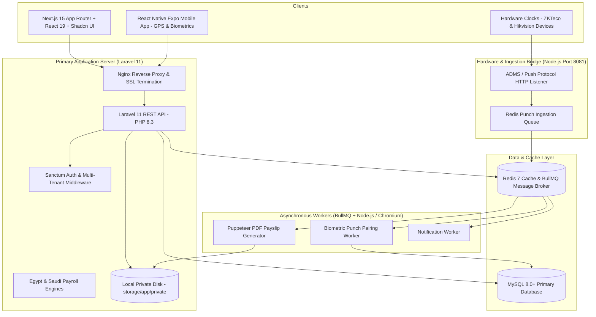

# Phase 04: System Architecture & API Design
## Laravel 11 Backend, Node.js Biometric Bridge & Next.js/Expo Architecture

This document specifies the technical architecture combining **Laravel 11 (PHP 8.3)** as the primary backend REST API, **MySQL 8.0+** and **Drizzle ORM**, **Redis 7 + BullMQ**, a dedicated **Node.js Hardware Bridge** for ZKTeco/Hikvision ADMS punches, a **Puppeteer Worker** for encrypted PDF generation, and **Local Private Storage**.

---

## 🏗️ System Architecture Topology



---

## 📟 Node.js Hardware Bridge for Biometric Clocks (ZKTeco & Hikvision)

Biometric devices (such as ZKTeco SilkBio, uFace, or Hikvision Terminals) communicate using the **ADMS (Automatic Data Master Server)** HTTP Push protocol.

### Implementation Pattern (`bridge/adms-server.ts`):
The listener runs as a lightweight Node.js service on port `8081`:

```typescript
import Fastify from 'fastify';
import { Queue } from 'bullmq';
import Redis from 'ioredis';

const redis = new Redis(process.env.REDIS_URL || 'redis://127.0.0.1:6379');
const punchQueue = new Queue('biometric-punches', { connection: redis });

const fastify = Fastify({ logger: true });

// 1. ZKTeco Device Handshake / Initial Registry
fastify.get('/iclock/cdata', async (request, reply) => {
  const query = request.query as { SN?: string; options?: string };
  fastify.log.info(`Handshake received from device SN: ${query.SN}`);
  
  // Return standard ADMS configuration handshake response
  return reply
    .type('text/plain')
    .send(`GET OPTION FROM: ${query.SN}\nATTLOGStamp=None\nOPERLOGStamp=None\nErrorDelay=30\nDelay=10\nTransTimes=00:00;14:05\nTransInterval=1\nTransFlag=1111000000\nTimeZone=2\nRealtime=1\nEncrypt=0`);
});

// 2. Real-time Attendance Punch Ingestion (POST)
fastify.post('/iclock/cdata', async (request, reply) => {
  const query = request.query as { SN?: string; table?: string };
  const rawBody = request.body as string;

  if (query.table === 'ATTLOG') {
    // Format: "USER_PIN \t TIMESTAMP \t STATUS \t VERIFY_TYPE"
    const lines = rawBody.split('\n').filter(l => l.trim().length > 0);
    
    for (const line of lines) {
      const parts = line.split('\t');
      if (parts.length >= 2) {
        const [deviceUserId, punchTime, punchState] = parts;
        
        // Enqueue to Redis for asynchronous processing
        await punchQueue.add('process-punch', {
          deviceSerial: query.SN,
          deviceUserId: deviceUserId.trim(),
          punchTime: punchTime.trim(),
          punchState: punchState ? punchState.trim() : '0', // 0: Check-In, 1: Check-Out
          receivedAt: new Date().toISOString()
        });
      }
    }
  }

  // Acknowledge receipt to the device
  return reply.type('text/plain').send('OK');
});

fastify.listen({ port: 8081, host: '0.0.0.0' }, (err) => {
  if (err) throw err;
  console.log('Biometric ADMS Push Bridge listening on port 8081');
});
```

---

## 📱 Mobile Check-in (React Native Expo) with Geofencing & Biometrics

Employees authorized for mobile punching verify their identity locally on their phone (TouchID / FaceID) and capture their GPS coordinates.

### React Native Punch Handler (`app/screens/ClockInScreen.tsx`):
```typescript
import * as LocalAuthentication from 'expo-local-authentication';
import * as Location from 'expo-location';
import { api } from '@/services/api';

export async function handleMobileClockIn() {
  // 1. Biometric verification on device
  const hasHardware = await LocalAuthentication.hasHardwareAsync();
  if (hasHardware) {
    const authResult = await LocalAuthentication.authenticateAsync({
      promptMessage: 'Authenticate to Clock In',
      fallbackLabel: 'Use Passcode'
    });
    if (!authResult.success) {
      throw new Error('Biometric authentication failed.');
    }
  }

  // 2. Fetch high-accuracy GPS Coordinates
  const { status } = await Location.requestForegroundPermissionsAsync();
  if (status !== 'granted') {
    throw new Error('Location permission denied.');
  }

  const location = await Location.getCurrentPositionAsync({
    accuracy: Location.Accuracy.High
  });

  // 3. Dispatch to Laravel API
  const response = await api.post('/api/v1/attendance/punch', {
    source: 'MOBILE_GPS',
    latitude: location.coords.latitude,
    longitude: location.coords.longitude,
    clientTimestamp: new Date().toISOString()
  });

  return response.data;
}
```

---

## 🔒 Private Local Object Storage with Laravel 11

All sensitive files (contracts, resumes, medical leave slips, encrypted PDF payslips, WPS SIF files) are stored strictly on the server's private disk: `storage/app/private/...` and **never** in `public/`.

### Laravel Storage Controller (`app/Http/Controllers/SecureDocumentController.php`):
```php
namespace App\Http\Controllers;

use App\Models\EmployeeDocument;
use Illuminate\Http\Request;
use Illuminate\Support\Facades\Storage;
use Symfony\Component\HttpFoundation\BinaryFileResponse;

class SecureDocumentController extends Controller
{
    public function download(Request $request, string $documentId): BinaryFileResponse
    {
        $tenantId = $request->user()->tenant_id;
        
        $doc = EmployeeDocument::where('tenant_id', $tenantId)
            ->where('id', $documentId)
            ->firstOrFail();

        // RBAC Check: User must be document owner OR hold HR/Admin permissions
        $user = $request->user();
        if ($doc->employee_id !== $user->employee?->id && !$user->hasAnyRole(['HR_DIRECTOR', 'HR_EXEC', 'SUPER_ADMIN'])) {
            abort(403, 'Unauthorized access to confidential document.');
        }

        $privateDisk = Storage::disk('private');

        if (!$privateDisk->exists($doc->file_path)) {
            abort(404, 'File not found on secure storage.');
        }

        // Stream file without exposing public URL
        return response()->file($privateDisk->path($doc->file_path), [
            'Content-Type' => $doc->mime_type ?? 'application/pdf',
            'Content-Disposition' => 'inline; filename="' . basename($doc->original_name) . '"',
            'X-Frame-Options' => 'DENY',
            'Cache-Control' => 'no-store, no-cache, must-revalidate'
        ]);
    }
}
```

---

## ⚡ Puppeteer Worker for Encrypted PDF Payslips (`workers/payslip-pdf.worker.ts`)

A dedicated BullMQ Node.js worker generates pixel-perfect, password-protected PDF payslips:

```typescript
import { Worker, Job } from 'bullmq';
import puppeteer from 'puppeteer';
import * as fs from 'fs/promises';
import * as path from 'path';

interface PayslipJob {
  payslipId: string;
  tenantId: string;
  htmlContent: string;
  outputRelativePath: string; // e.g. "tenants/{tenantId}/payslips/2026-11/EMP001.pdf"
}

// Target Laravel's private storage path on the same server
const LARAVEL_PRIVATE_STORAGE = process.env.LARAVEL_PRIVATE_STORAGE_PATH || '/var/www/hrsystem-api/storage/app/private';

export const payslipPdfWorker = new Worker(
  'payslip-pdf-queue',
  async (job: Job<PayslipJob>) => {
    const { htmlContent, outputRelativePath } = job.data;
    const fullOutputPath = path.join(LARAVEL_PRIVATE_STORAGE, outputRelativePath);

    // Ensure directory exists
    await fs.mkdir(path.dirname(fullOutputPath), { recursive: true });

    const browser = await puppeteer.launch({
      headless: true,
      args: ['--no-sandbox', '--disable-setuid-sandbox']
    });

    const page = await browser.newPage();
    await page.setContent(htmlContent, { waitUntil: 'networkidle0' });

    // Render A4 PDF
    await page.pdf({
      path: fullOutputPath,
      format: 'A4',
      printBackground: true,
      margin: { top: '15mm', right: '15mm', bottom: '15mm', left: '15mm' }
    });

    await browser.close();

    return { filePath: outputRelativePath };
  },
  { concurrency: 4 }
);
```

---

## 🌐 Laravel 11 Multi-Tenant REST API Design

### Authentication & Tenant Scoping
Every request carries `Authorization: Bearer <token>` and identifies the tenant by **Subdomain** (e.g. `acme.hrsystem.com`) or header `X-Tenant-ID`.

### Core Endpoint Catalog

#### 1. Authentication & Tenant Session
| Method | Endpoint | Description |
| :--- | :--- | :--- |
| `POST` | `/api/v1/auth/login` | Authenticate user; returns Laravel Sanctum Token + Tenant Context |
| `POST` | `/api/v1/auth/logout` | Revoke current access token |
| `GET` | `/api/v1/auth/me` | Fetch active user, employee profile, assigned roles & permissions |

#### 2. Attendance & Punch Engine
| Method | Endpoint | Description |
| :--- | :--- | :--- |
| `POST` | `/api/v1/attendance/punch` | Mobile GPS or Web Check-In/Out. Validates branch geofence |
| `GET` | `/api/v1/attendance/my-summary` | Monthly attendance sheet (presents, absents, late minutes, OT) |
| `POST` | `/api/v1/attendance/regularize` | Submit regularisation request for missed biometric punch |
| `GET` | `/api/v1/attendance/branch/:id` | Daily branch attendance dashboard for managers |

#### 3. Leave Management
| Method | Endpoint | Description |
| :--- | :--- | :--- |
| `GET` | `/api/v1/leaves/balances` | Remaining and accrued leave quotas |
| `POST` | `/api/v1/leaves/requests` | Apply for leave (supports uploading medical slip to private storage) |
| `PATCH` | `/api/v1/leaves/requests/:id/approve` | Manager / HR approval action |
| `PATCH` | `/api/v1/leaves/requests/:id/reject` | Reject leave with mandatory justification |

#### 4. Payroll Engine (Egypt & Saudi Arabia)
| Method | Endpoint | Description |
| :--- | :--- | :--- |
| `POST` | `/api/v1/payroll/runs` | Initialize monthly payroll cycle |
| `POST` | `/api/v1/payroll/runs/:id/calculate` | Execute Gross-to-Net (Egypt SI/Tax or Saudi GOSI rules) |
| `GET` | `/api/v1/payroll/runs/:id/export-wps` | Download Saudi Mudad/WPS SIF file |
| `POST` | `/api/v1/payroll/runs/:id/publish` | Queue BullMQ PDF generation jobs & publish payslips |
| `GET` | `/api/v1/payslips/:id/download` | Secure streaming of payslip PDF from local storage |
