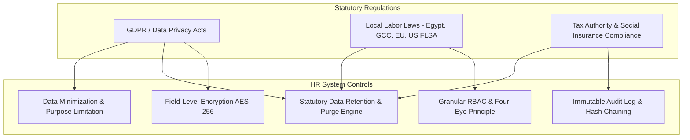
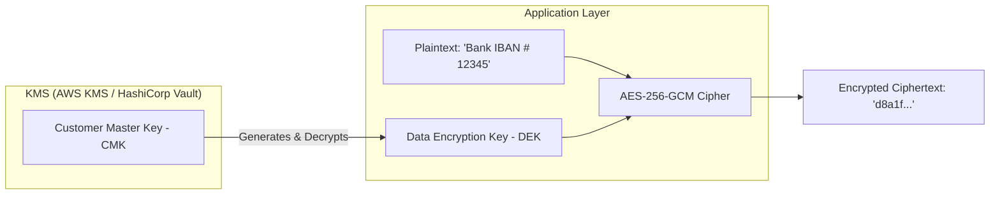

# Phase 05: Security, Compliance & Audit
## Data Privacy, Field-Level Encryption & Regulatory Governance

Human Resources Information Systems store the most confidential data in an enterprise: compensation, national identification numbers, banking details, performance appraisals, medical leaves, and disciplinary records. A single breach can cause catastrophic financial penalties, reputational damage, and legal liability.

This document details the security, cryptographic, compliance, and auditing controls embedded into the HR system.

---

## 🛡️ Regulatory Compliance Framework



### Statutory Retention Rules vs "Right to Be Forgotten"
While privacy regulations (such as GDPR Art. 17) grant employees the "Right to Erasure", labor and taxation laws mandate statutory minimum retention periods for employment and payroll data:

| Record Type | Statutory Retention Mandate | Post-Separation Treatment |
| :--- | :--- | :--- |
| **Recruitment / Non-hired Resumes** | 6 - 12 Months | Automatically anonymized/purged unless candidate opted in to talent pool. |
| **Time & Attendance Records** | 2 - 3 Years | Retained for wage/hour and overtime dispute defense. |
| **Tax, Social Insurance & Payroll** | 5 - 10 Years (Country specific) | Legally exempt from erasure requests; locked in read-only cold storage. |
| **Medical / Sick Leave Records** | 3 Years | Stored in isolated silo with restricted access (accessible only by authorized HR/Medical officer). |
| **Disciplinary & Investigation Notes** | Variable (often 1-3 years post-exit) | Sealed and accessible only by HR Director / Legal Counsel. |

---

## 🔐 Field-Level Encryption & Key Management (KMS)

Transparent Data Encryption (TDE) at the database storage level is insufficient because any user or query with DB read access can read plain-text values. The system enforces **Application-Layer Envelope Encryption** for sensitive fields:



### Encrypted Fields in Database:
- `employee_profiles.national_id_number`
- `employee_profiles.passport_number`
- `bank_accounts.account_number_encrypted`
- `bank_accounts.iban_encrypted`
- `employee_salaries.base_salary` (when elevated privacy mode is enabled)

### Implementation Pattern (Node.js / TypeScript):

```typescript
import crypto from 'crypto';

const ALGORITHM = 'aes-256-gcm';
const IV_LENGTH = 12; // 96 bits for GCM
const AUTH_TAG_LENGTH = 16; // 128 bits

interface EncryptedPayload {
  iv: string;
  tag: string;
  ciphertext: string;
}

export class FieldEncryptionService {
  private encryptionKey: Buffer;

  constructor(masterKeyHex: string) {
    this.encryptionKey = Buffer.from(masterKeyHex, 'hex');
  }

  encrypt(plaintext: string): string {
    const iv = crypto.randomBytes(IV_LENGTH);
    const cipher = crypto.createCipheriv(ALGORITHM, this.encryptionKey, iv);
    
    let encrypted = cipher.update(plaintext, 'utf8', 'hex');
    encrypted += cipher.final('hex');
    const tag = cipher.getAuthTag().toString('hex');

    // Format: iv:tag:ciphertext
    return `${iv.toString('hex')}:${tag}:${encrypted}`;
  }

  decrypt(packedCiphertext: string): string {
    const [ivHex, tagHex, encryptedData] = packedCiphertext.split(':');
    
    const decipher = crypto.createDecipheriv(
      ALGORITHM,
      this.encryptionKey,
      Buffer.from(ivHex, 'hex')
    );
    
    decipher.setAuthTag(Buffer.from(tagHex, 'hex'));
    
    let decrypted = decipher.update(encryptedData, 'hex', 'utf8');
    decrypted += decipher.final('utf8');
    
    return decrypted;
  }
}
```

---

## 📜 Cryptographic Audit Logging & Four-Eye Principle

### Four-Eye Principle (Dual Authorization)
For high-risk operations, the system prohibits single-person execution:
1. **Salary Adjustments:** Initiated by HR Specialist -> Requires sign-off by HR Director & Finance.
2. **Employee Bank Details Change:** Employee initiates -> Triggers verification alert; requires dual sign-off from Payroll Officer before new details become active.
3. **Backdated Attendance Corrections (> 30 days old):** Requires Department Head & HR Director approval.
4. **Final Payroll Disbursal:** Payroll Officer runs calculations -> CFO / Finance Director releases bank file.

### Cryptographic Hash-Chained Audit Trail
To ensure audit records cannot be silently modified by a malicious database administrator, each audit entry includes a cryptographic SHA-256 hash linking back to the previous entry:

$$\text{EntryHash}_n = \text{SHA256}(\text{EntryHash}_{n-1} + \text{Timestamp} + \text{ActorID} + \text{Action} + \text{PayloadJSON})$$

If an attacker modifies a row or deletes an entry in `audit_logs`, the chain breaks and automatic anomaly alarms trigger.

---

## 🔑 Authentication, MFA & Session Security

1. **Multi-Factor Authentication (MFA/2FA):**
   - Mandatory for all users holding `HR_EXEC`, `HR_DIRECTOR`, `PAYROLL_OFFICER`, and `SUPER_ADMIN` roles.
   - Standard TOTP (RFC 6238) compatible with Google Authenticator, 1Password, and Microsoft Authenticator.
2. **Single Sign-On (SSO):**
   - SAML 2.0 and OpenID Connect (OIDC) support for enterprise identity providers (Okta, Azure AD, Google Workspace).
   - Automated Just-in-Time (JIT) user provisioning and automated suspension upon offboarding.
3. **Session Hardening:**
   - Stateless JWT for API access with short lifetime (15 minutes).
   - Refresh tokens stored in `HttpOnly`, `SameSite=Strict`, `Secure` cookies with rotation on each use.
   - IP Whitelisting option for sensitive administrative endpoints (e.g. Payroll execution restricted to corporate VPN).

---

## 🗄️ Document Vault & Digital Signatures

1. **Time-Limited Pre-Signed URLs:**
   - Contracts, medical sick notes, and payslip PDFs stored in private S3 buckets (never public).
   - Downloads generated with strict 5-minute pre-signed URLs verified against user's tenant and role.
2. **Dynamic PDF Watermarking:**
   - Payslips and employment certificates dynamically watermarked with employee ID, download timestamp, and requesting IP address to prevent unauthorized internal leaks.
3. **e-Signature Non-Repudiation:**
   - Employment agreements and policy acknowledgments capture:
     - Signer's verified User ID
     - IP Address
     - User-Agent
     - Cryptographic SHA-256 hash of the exact PDF signed

