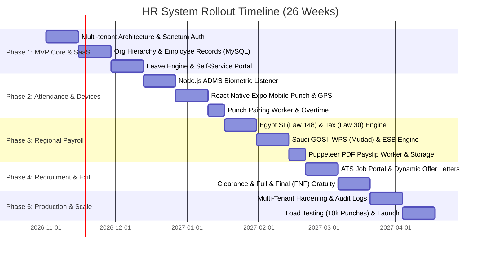

# Phase 06: Implementation Roadmap & Tech Stack
## Execution Strategy & Phased Delivery Milestones

This document outlines the tailored engineering roadmap for the confirmed technology stack and regional compliance targets:

- **Web Frontend:** Next.js 15 (App Router) + React 19 + Tailwind CSS + Shadcn UI
- **Mobile App:** React Native (Expo) with GPS Geofencing & Biometrics
- **Backend API:** Laravel 11 / PHP 8.3 REST API
- **Database & ORM:** MySQL 8.0+ + Drizzle ORM / Eloquent
- **Cache & Queues:** Redis 7 + BullMQ
- **Hardware Bridge:** Node.js Fastify ADMS HTTP Listener (ZKTeco / Hikvision)
- **Object Storage:** Laravel Private Local Disk on the same server
- **Document Generator:** Puppeteer (Chromium) BullMQ Worker
- **Jurisdictions:** Egypt (Tax Law 2024 / Law 148) & Saudi Arabia / GCC (GOSI / Qiwa / WPS Mudad / ESB)
- **Architecture:** Multi-Tenant SaaS

---

## 🗺️ 26-Week Phased Delivery Roadmap

---

## 🏗️ Phase-by-Phase Technical Breakdown

### 🎯 Phase 1: Multi-Tenant Core & Employee Directory (Weeks 1 – 6)
- **Deliverables:**
  - Laravel 11 project setup with MySQL 8.0+ schema migrations.
  - Multi-tenant isolation middleware (resolves tenant via subdomain / header and applies global scope `where('tenant_id', $tenantId)`).
  - Sanctum API authentication + 2FA TOTP support.
  - Organization structure: Companies, Branches (geofenced), Departments, Designations.
  - Employee Master Management: Employee profile, bank accounts, emergency contacts.
  - Next.js 15 Admin Portal: Responsive dashboard with Shadcn UI components and data tables.
  - Leave & Absence Engine: Leave types, accruals, application flow, and manager approvals.

### 🎯 Phase 2: Dual Attendance Hub — Biometrics & Mobile GPS (Weeks 7 – 11)
- **Deliverables:**
  - Standalone Node.js Fastify ADMS service (port 8081) receiving push requests from ZKTeco/Hikvision hardware.
  - Redis punch stream ingestion queue.
  - Attendance punch-pairing BullMQ worker matching check-in and check-out punches against branch shift policies.
  - React Native (Expo) mobile application with FaceID/TouchID and GPS location verification against branch geofence radius.
  - Configurable attendance mode per branch/employee (`BIOMETRIC_ONLY`, `MOBILE_GEOFENCE_ONLY`, or `BOTH`).
  - Attendance regularization workflow for missing punches.

### 🎯 Phase 3: Regional Payroll Engine (Egypt & Saudi Arabia) (Weeks 12 – 16)
- **Deliverables:**
  - **Egypt Engine:** Social Insurance Law 148 (caps and 11% / 18.75% rates), Income Tax progressive brackets (Law 30 / 2024 exemptions), and Comprehensive Health Insurance.
  - **Saudi Arabia Engine:** GOSI calculations for Saudi vs Expatriate, Article 84/85 End of Service Award (ESB) computation, and Wage Protection System (WPS / Mudad SIF file export).
  - Unpaid leave / Loss of Pay (LOP) and overtime automatic ingestion from attendance.
  - Puppeteer BullMQ Worker generating encrypted PDF payslips and saving directly to Laravel's private disk (`storage/app/private`).
  - Secure Laravel streaming download endpoint for payslips and documents.

### 🎯 Phase 4: Recruitment (ATS) & Offboarding (Weeks 17 – 20)
- **Deliverables:**
  - Job requisition and public careers page on Next.js.
  - Candidate pipeline stages, resume file storage, and interview scorecards.
  - Offer letter compilation with e-signature.
  - Offboarding lifecycle: Resignation submission, multi-department clearance (IT, Admin, Finance), and Full & Final (FNF) settlement.

### 🎯 Phase 5: Production Launch, Performance & Security (Weeks 21 – 26)
- **Deliverables:**
  - Field-level encryption for sensitive PII (National IDs, Iqama, IBANs).
  - Immutable SHA-256 hash-chained audit logging in MySQL.
  - Stress testing biometric ingestion to sustain 10,000 punches per hour.
  - Production deployment with Nginx, PHP-FPM 8.3, Supervisor for BullMQ/Laravel queues, and automated MySQL backups.
