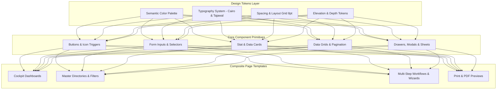
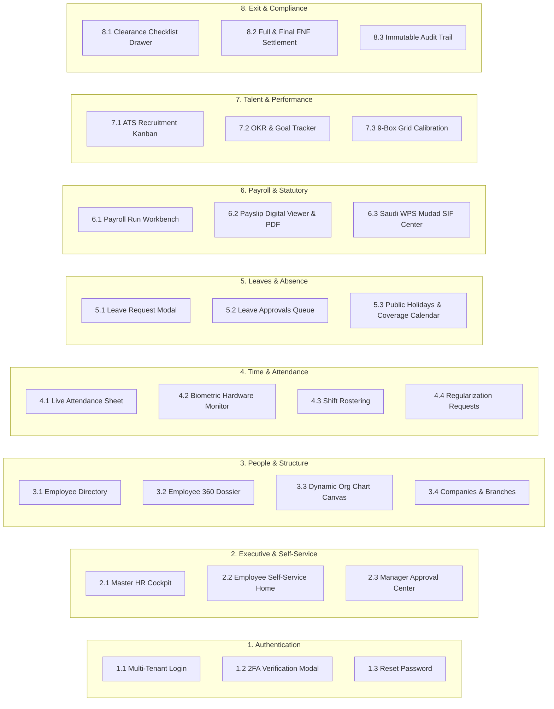

# Phase 08: Comprehensive UI/UX Design System & Page Specifications
## Enterprise HRIS / HCM — Design Tokens, Component Library & Screen Wireframes

This document provides the complete UI/UX architecture for every page in the Enterprise HRIS / HCM platform. It defines the design tokens, Arabic (RTL) and English (LTR) layout rules, accessibility standards (WCAG 2.1 AA), responsive breakpoints, and wireframe layout specifications for all system views.

---

## 🎨 1. Design System Foundation & Tokens



---

### 1.1 Color Palette & Semantic Roles

| Token Name | Hex Code | Light Mode Role | Dark Mode Role | Accessibility (WCAG) |
| :--- | :--- | :--- | :--- | :--- |
| **`primary-600`** | `#2563EB` | Main CTAs, Active Nav Items, Brand Accents | `#3B82F6` | Pass (AA on white) |
| **`primary-700`** | `#1D4ED8` | Button Hover, High-contrast links | `#60A5FA` | Pass (AAA) |
| **`success-500`** | `#10B981` | Approved status, Present punch, WPS SIF valid | `#34D399` | Pass (AA) |
| **`warning-500`** | `#F59E0B` | Pending approvals, Late punches, Iqama < 60 days | `#FBBF24` | Pass (AA) |
| **`danger-500`** | `#EF4444` | Absent, Terminated, Expired Iqama, Rejections | `#F87171` | Pass (AA) |
| **`neutral-50`** | `#F8FAFC` | Page body background | `#0F172A` | Base surface |
| **`neutral-100`** | `#F1F5F9` | Table headers, secondary button surface | `#1E293B` | Subtle borders |
| **`neutral-200`** | `#E2E8F0` | Card borders, dividers, disabled inputs | `#334155` | Subtle structure |
| **`neutral-700`** | `#334155` | Secondary text, table cells | `#94A3B8` | Pass (AAA) |
| **`neutral-900`** | `#0F172A` | Primary headings, titles | `#F8FAFC` | Pass (AAA) |

---

### 1.2 Typography System (Arabic & Latin Pairings)

- **Arabic Primary Typeface:** **Cairo** (`font-cairo`, Google Fonts) — Exceptional legibility on high-density data tables and small sizes down to 11px.
- **Arabic Secondary / Display:** **Tajawal** (`font-tajawal`) — Modern geometric headings and numbers.
- **Latin Fallback:** Inter / -apple-system / BlinkMacSystemFont.

```css
/* Typography Scale */
--text-xs:   0.75rem   (12px) /* Badges, helper text, timestamps */
--text-sm:   0.875rem  (14px) /* Table cells, form labels, body text */
--text-base: 1.0rem    (16px) /* Card titles, button labels */
--text-lg:   1.125rem  (18px) /* Sub-headers, modal headers */
--text-xl:   1.25rem   (20px) /* Section titles */
--text-2xl:  1.5rem    (24px) /* Page titles, metric card values */
--text-3xl:  1.875rem  (30px) /* Hero analytics metrics */
```

---

### 1.3 Bi-directional RTL & LTR Layout Rules

1. **Direction Mirrors:**
   - In **RTL (Arabic)**: Sidebar floats on the **Right**; Back buttons point to the **Right (`→`)**; Next buttons point to the **Left (`←`)**; Dropdown arrows align to the **Left**.
   - In **LTR (English)**: Standard mirrored orientation.
2. **Icons with Directionality:**
   - Direction-aware icons (`ChevronLeft`, `ChevronRight`, `ArrowRight`, `ArrowLeft`) dynamically swap based on `isRtl`.
   - Neutral icons (Search, Calendar, Clock, Download, User) remain orientation-fixed.
3. **Number Formatting:**
   - Currency and numerical digits default to international Arabic digits (`1, 2, 3...`) with localized thousand separators (`18,000 SAR` / `25,000 ج.م`).

---

## 📑 2. Global Information Architecture & Sitemap



---

## 🖥️ 3. Screen-by-Screen UI/UX Blueprints

---

### Screen 1: Multi-Tenant Login & 2FA Modal (`/auth/login`)

#### UX Objective:
Fast, secure authentication that automatically identifies the tenant by company subdomain (e.g. `acme.hrsystem.com`) or allows entering an organization code, followed by seamless TOTP 2FA verification.

#### Wireframe Layout:
```
+-----------------------------------------------------------------------------------+
|  [Brand Logo: HRSystem]                                  [Language Switcher: EN/ع] |
|                                                                                   |
|                   +--------------------------------------------+                  |
|                   |        تسجيل الدخول إلى حساب المنشأة         |                  |
|                   |   Future Holding Group | مجموعة المستقبل    |                  |
|                   +--------------------------------------------+                  |
|                   |                                            |                  |
|                   |  البريد الإلكتروني للعمل                     |                  |
|                   |  [ employee@futuregroup.com            ]   |                  |
|                   |                                            |                  |
|                   |  كلمة المرور                                |                  |
|                   |  [ **********************         (eye) ]  |                  |
|                   |                                            |                  |
|                   |  [x] تذكر هذا الجهاز لمدة 30 يوماً           |                  |
|                   |  [ نسيت كلمة المرور؟ ]                      |                  |
|                   |                                            |                  |
|                   |  [       تسجيل الدخول (Log In)          ]  |                  |
|                   |                                            |                  |
|                   |  ---------------- أو -----------------    |                  |
|                   |  [  (G) الدخول عبر Google Workspace    ]  |                  |
|                   |  [  (M) الدخول عبر Microsoft Azure AD  ]  |                  |
|                   +--------------------------------------------+                  |
|                                                                                   |
|  نظام مشفر ومطابق للوائح حماية البيانات والأمن السيبراني في مصر والمملكة          |
+-----------------------------------------------------------------------------------+
```

#### Micro-Interactions:
- **Tenant Auto-Detection:** If user visits `subdomain.hrsystem.com`, company branding and logo automatically replace the default logo.
- **2FA Modal Transition:** If the user has 2FA enabled, a 6-digit OTP modal slides in with auto-focus and auto-submit on the 6th digit.

---

### Screen 2: Master HR Cockpit & Executive Dashboard (`/`)

#### UX Objective:
Give HR Directors and C-Level Executives an instant snapshot of headcount health, daily attendance percentages, upcoming legal document expirations (Iqama/Visa), and estimated monthly payroll variance.

#### Wireframe Layout:
```
+-------------------------------------------------------------------------------------------------------------+
| [HR Logo] [شركة الرياض الرقمية v]   [Search Employees (Ctrl+K)...]    [🔔 3] [Language: AR] [Profile: AS v] |
+------------------+------------------------------------------------------------------------------------------+
| (Sidebar)        |  مرحباً بك، د. عبدالله السعيد 👋                               [ اليوم: الخميس 5 نوفمبر ]  |
| - لوحة القيادة   |  المقر الرئيسي: فرع العليا، الرياض | حالة النظام: متصل بالأجهزة الحيوية (Online)              |
| - سجل الموظفين   +------------------------------------------------------------------------------------------+
| - الحضور والانصراف| [ إجمالي الموظفين ] [ الحضور اليوم ] [ إجازات اليوم ] [ مسير رواتب الشهر ] [ تنبيهات الإقامة ] |
| - الإجازات       | [     148       ] [   142 (96%)  ] [      6       ] [   SAR 842,000    ] [ 3 إقامات تنتهي  ] |
| - مسير الرواتب   +------------------------------------------------------------------------------------------+
| - التوظيف (ATS)  | (قسم الحضور الذكي المزدوج)                                                               |
| - الأداء و OKRs  |  [📍 أنت داخل نطاق فرع الرياض (Geofence OK)]  [🟢 4 أجهزة ZKTeco/Hikvision متصلة]        |
| - إنهاء الخدمة   |  [  ✅ تسجيل حضور (Clock In)  ]   [  🕒 تسجيل خروج (Clock Out)  ]                        |
| - إعدادات النظام +------------------------------------------------------------------------------------------+
|                  | (الرسم البياني للتوزيع الديموغرافي)        | (الإجراءات والطلبات المعلقة للموافقة)        |
|                  | 🇸🇦 مواطنون: 68% | 🇪🇬 مقيمون: 32%          | • طلب إجازة سنوية: أحمد الشافعي [اعتماد]     |
|                  | [==========================..........]     | • تصحيح بصمة: سارة القحطاني [مراجعة]         |
|                  | توزيع حسب الأقسام: IT (45) | Sales (32)... | • مسير رواتب نوفمبر: بانتظار الاعتماد النهائي|
+------------------+------------------------------------------------------------------------------------------+
```

---

### Screen 3: Employee Master Directory (`/employees`)

#### UX Objective:
High-speed data grid for searching, filtering, and managing hundreds of employee records with multi-criteria filters (Department, Branch, Status, Attendance Mode) and bulk operations.

#### Wireframe Layout:
```
+-------------------------------------------------------------------------------------------------------------+
| سجل الموظفين (Employee Directory)                       [ تصدير Excel ] [ ⬇ استيراد ] [ + إضافة موظف جديد ] |
+-------------------------------------------------------------------------------------------------------------+
| [🔍 بحث بالاسم، الرقم الوظيفي، البريد...] [الفرع: الكل v] [القسم: الكل v] [الحالة: نشط v] [نوع الدوام: الكل v]|
+-------------------------------------------------------------------------------------------------------------+
| [x] | الرقم    | الموظف                  | القسم        | المسمى الوظيفي         | الفرع    | الحضور  | الحالة | إجراءات |
|-----+----------+-------------------------+--------------+------------------------+----------+---------+--------+---------|
| [ ] | EMP-SA01 | عبدالله سعد العتيبي     | تقنية المعلوم| Senior Software Eng    | 🇸🇦 الرياض| مزدوج   | [نشط]  | [••• v] |
| [ ] | EMP-EG01 | أحمد محمود الشافعي      | تقنية المعلوم| Lead Backend Engineer  | 🇪🇬 القاهرة| بصمة فقط| [نشط]  | [••• v] |
| [ ] | EMP-SA02 | سارة محمد القحطاني      | الموارد البشر| HR Operations Lead     | 🇸🇦 الرياض| محمول   | [نشط]  | [••• v] |
| [ ] | EMP-EG02 | نورهان طارق المنشاوي    | المالية      | Senior Payroll Officer | 🇪🇬 القاهرة| مزدوج   | [إجازة]| [••• v] |
+-------------------------------------------------------------------------------------------------------------+
| عرض 1 إلى 15 من أصل 148 موظفاً                              [الصفحة السابقة] [1] [2] [3] ... [الصفحة التالية]|
+-------------------------------------------------------------------------------------------------------------+
```

---

### Screen 4: Employee 360° Profile Dossier (`/employees/[id]`)

#### UX Objective:
A unified, tabbed dossier displaying everything about an employee in one place: Personal PII, Contracts, Bank info, Attendance punch history, Leave balances, Payslips, Assets held, and Document Vault.

#### Wireframe Layout:
```
+-------------------------------------------------------------------------------------------------------------+
| [← العودة لسجل الموظفين]                                                      [تعديل البيانات] [إجراءات v]   |
+-------------------------------------------------------------------------------------------------------------+
| (بطاقة الموظف العلوية)                                                                                       |
| [ Avatar ] عبدالله سعد العتيبي  (EMP-SA-001)            🇸🇦 مواطن سعودي  •  الحالة: [نشط]  •  دوام كامل      |
|            Senior Software Engineer | قسم تقنية المعلومات | فرع الرياض (Olaya) | المدير: م. فهد الدوسري     |
|            البريد: abdullah@futuregroup.com  |  الهاتف: +966501234567  |  تاريخ التعيين: 15 يناير 2023      |
+-------------------------------------------------------------------------------------------------------------+
| [ البيانات الشخصية ] [ الراتب والعقد ] [ الحضور والانصراف ] [ الإجازات ] [ مسير الرواتب ] [ العهد ] [ المستندات ] |
+-------------------------------------------------------------------------------------------------------------+
| (محتوى تبويب: الراتب والبدلات والعقد)                                                                       |
| • الراتب الأساسي:       SAR 18,000.00          • الحساب البنكي: مصرف الراجحي                                |
| • بدل السكن:            SAR 4,500.00           • الآيبان (IBAN): SA0380000000608010167519                  |
| • بدل الانتقال:          SAR 1,500.00           • رقم المشترك التأميني (GOSI): 987654321                    |
| ------------------------------------          ------------------------------------------                    |
| • إجمالي الراتب الشامل: SAR 24,000.00          • مكافأة نهاية الخدمة المتراكمة: SAR 27,000.00                |
| • استقطاع التأمينات:   -SAR 2,193.75 (9.75%)  • صافي الراتب التقديري: SAR 21,806.25                         |
+-------------------------------------------------------------------------------------------------------------+
```

---

### Screen 5: Live Attendance & Biometric Monitor (`/attendance`)

#### UX Objective:
Real-time visibility into today's punches across physical ZKTeco/Hikvision biometric clocks and mobile GPS geofenced check-ins, with instant regularization tools for missing punches.

#### Wireframe Layout:
```
+-------------------------------------------------------------------------------------------------------------+
| الحضور والانصراف (Time & Attendance Hub)                      [ تصدير التقرير ] [ معالجة بصمات اليوم ]     |
+-------------------------------------------------------------------------------------------------------------+
| (شريط حالة أجهزة البصمة الحيوية Hardware Status)                                                             |
| • [🟢 جهاز فرع العليا (ZKTeco SilkBio)]: متصل - آخر مزامنة قبل دقيقة واحدة (142 حركة مسجلة)                  |
| • [🟢 جهاز فرع القاهرة (Hikvision Face)]: متصل - آخر مزامنة قبل 30 ثانية (98 حركة مسجلة)                    |
| • [🟢 محرك النطاق الجغرافي للمحمول (Mobile Geofence)]: نشط ومعاير على نطاق 200 متر                          |
+-------------------------------------------------------------------------------------------------------------+
| [تاريخ: اليوم 5 نوفمبر 2026] [الفرع: كل الفروع v] [الوردية: الصباحية (09:00 - 17:00) v] [الحالة: الكل v]    |
+-------------------------------------------------------------------------------------------------------------+
| الموظف                  | أول حضور (In) | آخر انصراف (Out) | ساعات العمل | التأخير   | المصدر    | الإجراء   |
|-------------------------+---------------+------------------+-------------+-----------+-----------+-----------|
| عبدالله سعد العتيبي     | 08:52 AM      | 05:08 PM         | 8.25 ساعة   | 0 دقيقة   | 📱 محمول  | [تفاصيل]  |
| أحمد محمود الشافعي      | 09:18 AM      | --:-- --         | قيد الدوام  | 18 دقيقة  | 📟 بصمة   | [تصحيح]   |
| سارة محمد القحطاني      | 09:01 AM      | 05:00 PM         | 8.00 ساعة   | 0 دقيقة   | 📱 محمول  | [تفاصيل]  |
| طارق إبراهيم الدسوقي    | --:-- --      | --:-- --         | 0.00 ساعة   | غائب      | --        | [طلب عذر] |
+-------------------------------------------------------------------------------------------------------------+
```

---

### Screen 6: Leave Management & Approvals Center (`/leaves`)

#### UX Objective:
Manage annual, sick, and statutory leaves with clear quota balance pills, sandwich-leave warnings, medical certificate attachments, and multi-tier manager sign-offs.

#### Wireframe Layout:
```
+-------------------------------------------------------------------------------------------------------------+
| إدارة الإجازات (Leave Management)                                             [ + تقديم طلب إجازة جديد ]    |
+-------------------------------------------------------------------------------------------------------------+
| [ أرصدتي الشخصية ]: [ 🏖️ سنوية: 21 يوماً (متبقي 16) ] [ 🤒 مرضية: 15 يوماً (متبقي 15) ] [ 👶 أمومة: 90 يوماً ]|
+-------------------------------------------------------------------------------------------------------------+
| [ تبويب: طلبات بانتظار موافقتي (3) ]   [ تبويب: طلباتي الشخصية ]   [ تبويب: تقويم إجازات الفريق والفرع ]      |
+-------------------------------------------------------------------------------------------------------------+
| بطاقة طلب معلق للموافقة:                                                                                    |
| • الموظف: أحمد محمود الشافعي (فرع القاهرة)                                                                  |
| • نوع الإجازة: إجازة سنوية (Annual Leave)  | المدة: 4 أيام عمل (من الأحد 10 نوفمبر إلى الأربعاء 13 نوفمبر)    |
| • السبب: ظرف عائلي وسفر خاص                | الرصيد المتبقي بعد الخصم: 12 يوماً                              |
| • تنبيه النظام: لا يوجد تضارب مع مهندسين آخرين في نفس القسم خلال هذه الفترة                                 |
|                                                                                                             |
| [  ✅ اعتماد الإجازة (Approve)  ]       [  ❌ رفض الطلب (مع كتابة السبب)  ]       [  تفاصيل سجل الإجازات  ]  |
+-------------------------------------------------------------------------------------------------------------+
```

---

### Screen 7: Statutory Payroll Run Workbench (`/payroll`)

#### UX Objective:
The financial heart of the HR system. Ingests attendance, calculates gross-to-net under Egyptian or Saudi labor laws with a single click, flags >10% variance, generates encrypted payslips, and exports Saudi Mudad WPS SIF banking files.

#### Wireframe Layout:
```
+-------------------------------------------------------------------------------------------------------------+
| مسير الرواتب والأجور (Payroll & Compensation)               [ تصفية الشهر السابق ] [ + إعداد مسير شهر جديد ]|
+-------------------------------------------------------------------------------------------------------------+
| دورة الرواتب النشطة: مسير شهر نوفمبر 2026 (تاريخ الصرف: 27 نوفمبر 2026)             الحالة: [تم الحساب - معلق] |
| الشركة: شركة الرياض للحلول الرقمية (فرع السعودية) | نظام الامتثال: التأمينات السعودية (GOSI) وحماية الأجور (WPS)|
+-------------------------------------------------------------------------------------------------------------+
| [ إجمالي الراتب الشامل ]   [ استقطاع التأمينات (GOSI) ]   [ خصومات الغياب/الجزاءات ]   [ صافي الرواتب للدفع ]|
| [     SAR 942,000      ]   [       -SAR 84,200        ]   [       -SAR 3,400       ]   [    SAR 854,400     ]|
+-------------------------------------------------------------------------------------------------------------+
| تنبيهات التدقيق المالي المسبق (Pre-Audit Checks):                                                           |
| ⚠️ تم اكتشاف زيادة بنسبة 14% في قسم IT بسبب ساعات عمل إضافية معتمدة لـ 3 موظفين. [عرض التفاصيل والاعتماد]  |
| 🟢 لا توجد أي رواتب سالبة أو خصومات تتجاوز الحد النظامي (50% من إجمالي الراتب).                              |
+-------------------------------------------------------------------------------------------------------------+
| جدول مسير رواتب الموظفين (Batch Sheet):                                                                     |
| الرقم    | الموظف             | الراتب الأساسي | البدلات    | استقطاع GOSI | خصم غياب | صافي الراتب | قسيمة الراتب |
|----------+--------------------+----------------+------------+--------------+----------+-------------+-------------|
| EMP-SA01 | عبدالله سعد العتيبي| SAR 18,000     | SAR 6,000  | -SAR 2,193   | SAR 0.00 | SAR 21,806  | [عرض PDF]   |
| EMP-EG01 | أحمد محمود الشافعي | SAR 14,000     | SAR 3,000  | -SAR 280 (2%)| SAR 0.00 | SAR 16,720  | [عرض PDF]   |
+-------------------------------------------------------------------------------------------------------------+
| [  🚀 اعتماد المسير النهائي (Finance Sign-off)  ]  [  📄 إصدار ملف حماية الأجور (Mudad SIF)  ]  [  📧 نشر القسائم  ]|
+-------------------------------------------------------------------------------------------------------------+
```

---

### Screen 8: Digital Payslip Preview & PDF Modal

#### UX Objective:
A bilingual, tamper-proof, pixel-perfect preview of the monthly payslip with company header, earnings, statutory deductions, employer contributions, and QR verification stamp.

#### Wireframe Layout:
```
+------------------------------------------------------------------------------------+
|  [X] إغلاق نافذة المعاينة                                     [ 🖨️ طباعة ] [ ⬇ تحميل PDF ]  |
+------------------------------------------------------------------------------------+
|                                                                                    |
|   +----------------------------------------------------------------------------+   |
|   |  شركة الرياض للحلول الرقمية ذ.م.م                      قسيمة راتب شهرية     |   |
|   |  Riyadh Digital Solutions LLC                      Monthly Payslip         |   |
|   |  السجل التجاري: 1010892341  •  الرقم الضريبي: 300123456700003              |   |
|   +----------------------------------------------------------------------------+   |
|   | الموظف: عبدالله سعد العتيبي          الرقم الوظيفي: EMP-SA-001             |   |
|   | القسم: تقنية المعلومات (IT)           المسمى: Senior Software Engineer      |   |
|   | البنك: مصرف الراجحي                   الآيبان: SA0380000000608010167519    |   |
|   | فترة الراتب: 01-11-2026 إلى 30-11-2026 تاريخ الاستحقاق: 27-11-2026          |   |
|   +-------------------------------------+--------------------------------------+   |
|   | المستحقات والأجور (Earnings)         | الاستقطاعات والخصومات (Deductions)    |   |
|   +-------------------------------------+--------------------------------------+   |
|   | • الراتب الأساسي:        SAR 18,000 | • تأمينات اجتماعية (GOSI 9.75%):    |   |
|   | • بدل السكن:             SAR 4,500  |                              SAR 2,193|   |
|   | • بدل المواصلات:         SAR 1,500  | • غياب / تأخير:               SAR 0.00|   |
|   | • عمل إضافي معتمد:       SAR 0.00   | • خصومات أخرى:                SAR 0.00|   |
|   +-------------------------------------+--------------------------------------+   |
|   | إجمالي المستحقات:        SAR 24,000 | إجمالي الاستقطاعات:          SAR 2,193|   |
|   +-------------------------------------+--------------------------------------+   |
|   |                                                                            |   |
|   |   صافي الراتب المحول للحساب البنكي:        SAR 21,806.25                    |   |
|   |   (فقط واحد وعشرون ألف وثمانمائة وستة ريالات سعودية و 25 هللة)             |   |
|   |                                                                            |   |
|   |   [QR Code التحقق الرقمي المعتمد]             توقيع وختم الإدارة المالية    |   |
|   +----------------------------------------------------------------------------+   |
+------------------------------------------------------------------------------------+
```

---

### Screen 9: Talent Acquisition (ATS) Recruitment Pipeline (`/recruitment`)

#### UX Objective:
Visual Kanban board organizing candidate flow through hiring stages with structured scorecard rating rubrics.

#### Wireframe Layout:
```
+-------------------------------------------------------------------------------------------------------------+
| التوظيف واستقطاب الكفاءات (ATS Pipeline)                     [ الوظائف النشطة: 4 ] [ + نشر إعلان وظيفي جديد ]|
+-------------------------------------------------------------------------------------------------------------+
| وظيفة: Senior Full Stack Engineer (الرياض - دوام كامل)       [تصفية حسب التقييم v] [بحث عن مرشح...]        |
+-------------------+-------------------+-------------------+-------------------+-----------------------------+
| تم التقديم (18)   | الفرز الأولي (6)  | المقابلة الفنية(4)| عرض العمل (2)     | تم التعيين (1)              |
+-------------------+-------------------+-------------------+-------------------+-----------------------------+
| [ بطاقة مرشح ]    | [ بطاقة مرشح ]    | [ بطاقة مرشح ]    | [ بطاقة مرشح ]    | [ بطاقة مرشح ]              |
| م. عمر خالد       | م. سامي الجابري   | م. يوسف حسن       | م. حازم رضوان     | م. عبدالله العتيبي          |
| تقييم: ★★★★☆ (4.2)| تقييم: ★★★★☆ (4.5)| تقييم: ★★★★★ (4.9)| الراتب: 22,000 SAR| باشر العمل: 15-01-2023      |
| خبرة: 5 سنوات     | خبرة: 6 سنوات     | جولة فنية ثانية   | العرض مرسل للتوقيع| مكتمل التهيئة               |
| [عرض السيرة الذاتية] [تحديد مقابلة]   | [تسجيل الدرجات]   | [إرسال تذكير]     | [عرض ملف الموظف]            |
+-------------------+-------------------+-------------------+-------------------+-----------------------------+
```

---

### Screen 10: Offboarding & Full & Final (FNF) Clearance (`/offboarding`)

#### UX Objective:
Transparent, audit-backed separation workflow coordinating multi-department clearance (IT device wiping, Admin key return, Finance settlement) and calculating Article 84/85 End of Service Award automatically.

#### Wireframe Layout:
```
+-------------------------------------------------------------------------------------------------------------+
| تصفية المستحقات وإنهاء الخدمة (Offboarding & Clearance)                       [ + تسجيل طلب استقالة/إنهاء ] |
+-------------------------------------------------------------------------------------------------------------+
| طلب نشط: م. خالد عبدالرحمن القرني (رقم: EMP-SA-044) | نوع الانفصال: استقالة نظامية (Resignation)            |
| تاريخ الإخطار: 01 أكتوبر 2026  |  آخر يوم عمل تعاقدي: 31 أكتوبر 2026  |  سنوات الخدمة المتصلة: 4 سنوات و 6 أشهر |
+-------------------------------------------------------------------------------------------------------------+
| مراحل إخلاء الطرف الإداري (Departmental Clearances):                                                        |
| • [✅ قسم تقنية المعلومات IT]: تم تسليم الحاسب المحمول (MacBook Pro) وإلغاء صلاحيات البريد و SSO           |
| • [✅ الشؤون الإدارية Admin]: تم استلام بطاقة دخول المبنى وبطاقة وقوف السيارات                             |
| • [✅ الإدارة المالية Finance]: تم تسوية العهد النقدية ومطابقة بطاقة الشركة الائتمانية                     |
+-------------------------------------------------------------------------------------------------------------+
| الحساب النهائي لمكافأة نهاية الخدمة (Article 84 & 85 Statutory Calculation):                                |
| • الراتب الأخير المعتمد للمكافأة:         SAR 16,000.00                                                     |
| • الاستحقاق الأساسي (نصف شهر عن كل سنة): SAR 36,000.00                                                     |
| • معامل الاستقالة (بين سنتين إلى 5 سنوات): ثلث المكافأة (1/3 under Art. 85) = SAR 12,000.00                |
| • رصيد الإجازات غير المستنفذ (8 أيام):   +SAR 4,266.66                                                     |
| • راتب الشهر الأخير المستحق:             +SAR 16,000.00                                                     |
| ----------------------------------------------------------------------------------------------------------- |
| • صافي التصفية النهائية الإجمالي (Net FNF): SAR 32,266.66                                                   |
+-------------------------------------------------------------------------------------------------------------+
| [  ✅ اعتماد الشؤون القانونية والموارد البشرية  ]   [  📄 طباعة شهادة الخبرة وإخلاء الطرف  ]   [  إغلاق الملف  ]|
+-------------------------------------------------------------------------------------------------------------+
```

---

## 📐 4. Responsive Breakpoint Strategy

| Breakpoint | Width (px) | Targeted Devices | Key Layout Adjustments |
| :--- | :--- | :--- | :--- |
| **Mobile (`sm`)** | `< 640px` | iPhone / Android phones | Sidebar collapses to slide-over bottom sheet; tables switch to responsive cards; stats stack vertically. |
| **Tablet (`md`)** | `640px – 1024px` | iPads, Tablets, Foldables | Sidebar collapses to icon rail; 2-column stat cards; horizontal table scrolling. |
| **Desktop (`lg`)** | `1024px – 1440px` | Standard Laptops, MacBooks | Full permanent sidebar with badges; 4-column metric cards; full data tables. |
| **Ultra-Wide (`2xl`)** | `> 1440px` | 4K & Ultrawide Monitors | Max container clamped at `1440px` with central alignment to prevent visual fatigue. |

