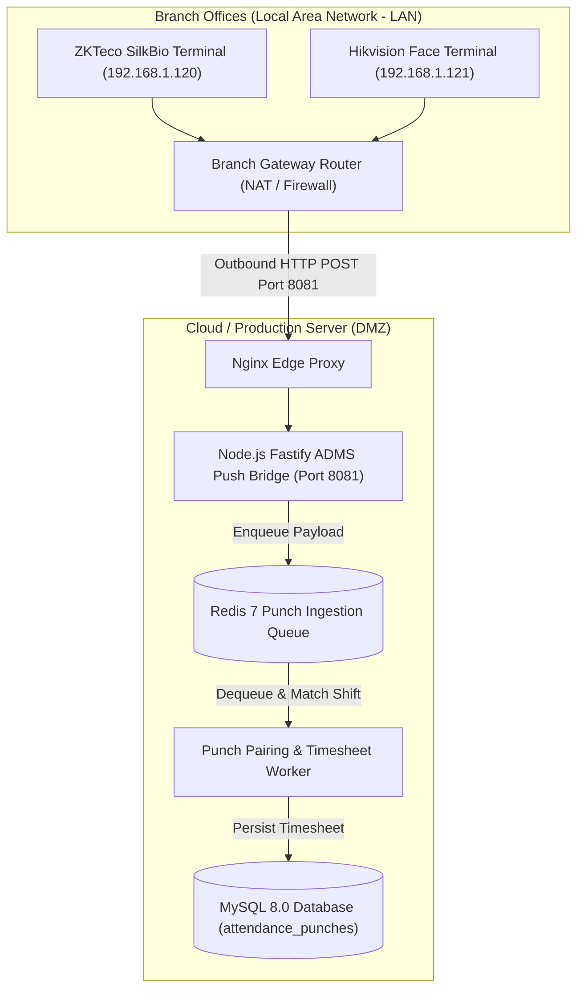

# Phase 09: Hardware Biometrics & IoT Integration Specification
## ZKTeco ADMS, Hikvision ISAPI & Biometric Push Protocols

This document details the low-level communication protocols, packet formats, device synchronization commands, network topologies, and fail-safe buffering for physical biometric attendance clocks (fingerprint, facial recognition, palm, and RFID readers).

---

## 🌐 Network Architecture & Topology



> [!IMPORTANT]
> The biometric devices initiate all connections **outbound** from the branch office to the cloud server via standard HTTP/HTTPS. No port forwarding, public static IPs, or inbound firewall holes are required at branch office locations.

---

## 📟 1. ZKTeco ADMS (Automatic Data Master Server) Push Protocol

ZKTeco devices configured with the **ADMS / Cloud Server** firmware module communicate using HTTP request/response sequences.

### 1.1 Device Handshake & Registry (`GET /iclock/cdata`)
When the terminal powers on or reconnects to the network, it issues an HTTP GET request to verify server parameters:

#### Request:
```http
GET /iclock/cdata?SN=BKD81900214&options=all&pushver=2.4.1 HTTP/1.1
Host: adms.hrsystem.com:8081
User-Agent: iClock Proxy/1.0
Connection: close
```

#### Server Response (Required Payload):
The server must return plain-text configuration flags instructing the device how frequently to push records:
```http
HTTP/1.1 200 OK
Content-Type: text/plain
Content-Length: 182

GET OPTION FROM: BKD81900214
ATTLOGStamp=None
OPERLOGStamp=None
ErrorDelay=30
Delay=10
TransTimes=00:00;14:05
TransInterval=1
TransFlag=1111000000
TimeZone=3
Realtime=1
Encrypt=0
```

- `Realtime=1`: Enables instant push mode (device pushes punches within <1 second of verification).
- `TransInterval=1`: Polling interval in minutes if realtime push drops.
- `TimeZone=3`: Sets terminal time zone (UTC+3 for Riyadh/Saudi Arabia, UTC+2 for Cairo/Egypt).

---

### 1.2 Real-time Attendance Punch Ingestion (`POST /iclock/cdata`)
When an employee scans their face or fingerprint, the terminal packages the event and sends an HTTP POST:

#### Request:
```http
POST /iclock/cdata?SN=BKD81900214&table=ATTLOG&Stamp=9999 HTTP/1.1
Host: adms.hrsystem.com:8081
Content-Type: text/plain
Content-Length: 58

1001\t2026-11-05 08:52:14\t0\t1\t0\t0
1002\t2026-11-05 08:53:01\t0\t15\t0\t0
```

#### Payload Format (Tab-Separated `\t`):
$$\text{UserPIN} \quad \text{Timestamp (YYYY-MM-DD HH:MM:SS)} \quad \text{PunchState} \quad \text{VerifyType} \quad \text{WorkCode} \quad \text{Reserved}$$

- **PunchState:**
  - `0`: Clock-In (تسجيل حضور)
  - `1`: Clock-Out (تسجيل انصراف)
  - `2`: Break-Out (خروج استراحة)
  - `3`: Break-In (عودة من استراحة)
  - `4`: Overtime-In (دخول عمل إضافي)
  - `5`: Overtime-Out (خروج عمل إضافي)
- **VerifyType:**
  - `1`: Fingerprint (بصمة إصبع)
  - `15`: Facial Recognition (بصمة وجه)
  - `2`: Card / RFID (بطاقة ذكية)
  - `0`: Password / PIN (رمز مرور)

#### Server Acknowledgement:
The server **must** reply with `OK` or `OK: Count` so the terminal marks the logs as transmitted:
```http
HTTP/1.1 200 OK
Content-Type: text/plain

OK
```

---

## 📷 2. Hikvision ISAPI / HTTP Event Notification Protocol

Hikvision Face Recognition Terminals (e.g. MinMoe series) deliver structured JSON or multipart XML payloads via HTTP POST when connected to a configured listener URL (`/api/hikvision/event`).

### 2.1 Event Webhook Payload Schema:
```json
{
  "ipAddress": "192.168.10.45",
  "portNo": 80,
  "protocol": "HTTP",
  "macAddress": "bc:ad:28:44:11:02",
  "channelID": 1,
  "dateTime": "2026-11-05T09:18:22+02:00",
  "activePostCount": 1,
  "eventType": "AccessControllerEvent",
  "eventState": "active",
  "eventDescription": "Access Controller Event",
  "AccessControllerEvent": {
    "deviceName": "Cairo_Branch_Turnstile_01",
    "majorEventType": 5,
    "subEventType": 75,
    "cardNo": "99214022",
    "employeeNoString": "1002",
    "cardType": 1,
    "attendanceStatus": "checkIn",
    "statusValue": 0,
    "verifyStyle": "face",
    "name": "أحمد محمود الشافعي",
    "userType": "normal"
  }
}
```

---

## 🔄 3. Remote Device Command Dispatch (Push Protocol Commands)

The server can instruct physical terminals to perform administrative actions (e.g., enrolling a new employee, deleting a terminated employee, or setting the device clock) during the `GET /iclock/getrequest` polling sequence.

### Command Catalog:

| Command String | Function | Use Case |
| :--- | :--- | :--- |
| `C:101:DATA UPDATE USER PIN=1003\tName=Omar\tPri=0\tPass=1234` | Create / Update User | New employee onboarded |
| `C:102:DATA DELETE USER PIN=1044` | Delete User from Device | Employee offboarded / terminated |
| `C:103:CHECK` | Request Terminal Device Audit | Diagnostics & heartbeat check |
| `C:104:SET OPTIONS DateTime=2026-11-05 04:00:00` | Synchronize Device Clock | Prevent time drift fraud |
| `C:105:REBOOT` | Restart Terminal Hardware | Routine scheduled maintenance |

---

## 🛡️ 4. Fail-Safe Buffering & Network Disconnection Handling

1. **Terminal Offline Storage:**
   - Physical terminals store up to **100,000 to 200,000 attendance records** in onboard non-volatile flash memory.
   - If the branch office internet connection is severed, employees can continue punching normally.
   - Once internet is restored, the terminal automatically bursts all buffered punches in chronological order using the `ATTLOGStamp` watermark.
2. **De-duplication & Idempotency:**
   - The BullMQ worker validates punches using a unique composite index in MySQL:
     `UNIQUE KEY uk_punch_unique (device_serial, biometric_user_id, punch_time)`.
   - Any duplicate punches received during network retries are dropped without skewing timesheets.
