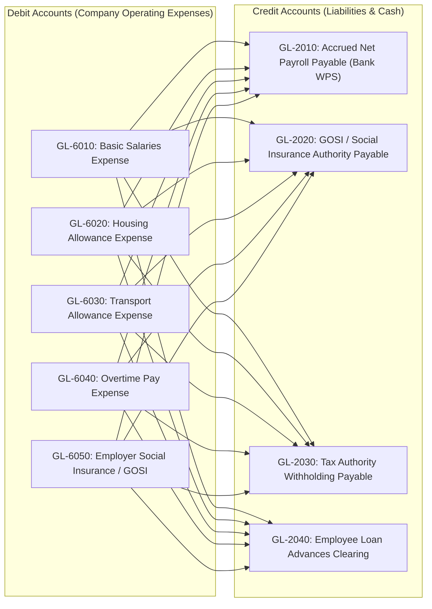

# Phase 10: Payroll Mathematical Specifications & Accounting Ledger
## Mathematical Models, Edge Cases & General Ledger (GL) Double-Entry Bookkeeping

This document provides the formal mathematical specifications for all payroll calculations, mid-month edge cases, and the **General Ledger (GL) double-entry accounting journal entries** required for integrating with enterprise ERPs (SAP S/4HANA, Oracle Fusion, NetSuite, Microsoft Dynamics 365, and QuickBooks).

---

## 📐 1. Mathematical Formulation for Payroll Edge Cases

---

### 1.1 Mid-Month Salary Adjustment (Promotions & Increment Split)

When an employee receives a salary change on day $d_{\text{effective}}$ of a month with $D_{\text{total}}$ days:

$$\text{Gross}_{\text{month}} = \left( \frac{d_{\text{effective}} - 1}{D_{\text{total}}} \times \text{Salary}_{\text{old}} \right) + \left( \frac{D_{\text{total}} - d_{\text{effective}} + 1}{D_{\text{total}}} \times \text{Salary}_{\text{new}} \right)$$

#### Example:
- Employee promoted on **November 16** in a 30-day month.
- Old Salary: 15,000 SAR | New Salary: 21,000 SAR.
$$\text{Gross}_{\text{month}} = \left( \frac{15}{30} \times 15,000 \right) + \left( \frac{15}{30} \times 21,000 \right) = 7,500 + 10,500 = 18,000 \text{ SAR}$$

---

### 1.2 Unpaid Leave / Loss of Pay (LOP) & The Statutory Cap

Under **Saudi Labor Law (Article 93)** and **Egyptian Labor Law (Article 42)**, total monthly deductions from an employee's salary **must not exceed 50%** of their gross monthly salary, unless authorized by a court order or child support decree.

$$\text{LOP Deduction} = \frac{\text{Base Salary} + \text{Fixed Allowances}}{D_{\text{divisor}}} \times N_{\text{absent}}$$

Where $D_{\text{divisor}}$ is configured per organization:
- **Standard Convention:** $D_{\text{divisor}} = 30$ days.
- **Working Days Convention:** $D_{\text{divisor}} = 22$ working days (or 26 working days).

#### Safe Deduction Enforcement:
$$\text{Total Deductions}_{\text{enforced}} = \min\left( \text{Total Deductions}_{\text{calculated}}, \ 0.50 \times \text{Gross Salary} \right)$$
$$\text{Excess Unrecovered} = \text{Total Deductions}_{\text{calculated}} - \text{Total Deductions}_{\text{enforced}} \quad \longrightarrow \text{Carried forward to Month } m+1$$

---

### 1.3 Saudi Labor Law End of Service Award (Articles 84, 85 & 87)

Let $W_{\text{last}}$ be the last monthly comprehensive wage, and $Y$ be the total continuous service years.

#### Base Entitlement Function $E_{\text{base}}(Y)$:
$$E_{\text{base}}(Y) = \begin{cases} 
\left( \frac{W_{\text{last}}}{2} \right) \times Y & \text{if } Y \le 5 \\[2ex]
\left( \frac{W_{\text{last}}}{2} \right) \times 5 + W_{\text{last}} \times (Y - 5) & \text{if } Y > 5 
\end{cases}$$

#### Resignation Factor Multiplier $R(Y)$:
$$R(Y) = \begin{cases} 
0 & \text{if } Y < 2 \\[1ex]
\frac{1}{3} & \text{if } 2 \le Y \le 5 \\[1ex]
\frac{2}{3} & \text{if } 5 < Y \le 10 \\[1ex]
1.0 & \text{if } Y > 10 
\end{cases}$$

#### Final Award Payout:
$$\text{ESB} = E_{\text{base}}(Y) \times R(Y)$$
*(Note: If separation is initiated by employer termination, redundancy, or female employee marriage within 6 months, $R(Y) = 1.0$ regardless of tenure).*

---

## 🏛️ 2. General Ledger (GL) Double-Entry Accounting Architecture

When a payroll cycle is approved and finalized, the system automatically compiles a balanced **General Ledger Journal Entry** for export to the finance ERP.

### Standard Accounting Equation:
$$\sum \text{Debits} \equiv \sum \text{Credits}$$



---

### 2.1 Standard Journal Entry Table (Batch Run Example)

#### Batch Parameters:
- Total Basic Salaries: **SAR 600,000**
- Total Housing Allowances: **SAR 150,000**
- Total Transportation: **SAR 50,000**
- Approved Overtime: **SAR 20,000**
- Employee GOSI Deductions (9.75%): **SAR 73,125**
- Employer GOSI Contributions (11.75%): **SAR 88,125**
- Salary Advances / Loans Recovered: **SAR 10,000**
- Net Bank Disbursal via WPS: **SAR 736,875**

| Account Code | Account Description | Category | Debit (SAR) | Credit (SAR) |
| :--- | :--- | :--- | :---: | :---: |
| **`GL-6010`** | Salaries Expense - Basic | Expense (P&L) | **600,000.00** | — |
| **`GL-6020`** | Housing Allowance Expense | Expense (P&L) | **150,000.00** | — |
| **`GL-6030`** | Transport Allowance Expense | Expense (P&L) | **50,000.00** | — |
| **`GL-6040`** | Overtime Pay Expense | Expense (P&L) | **20,000.00** | — |
| **`GL-6050`** | Employer Social Security Expense (GOSI) | Expense (P&L) | **88,125.00** | — |
| **`GL-2010`** | Net Salaries Payable (WPS Clearing) | Current Liability | — | **736,875.00** |
| **`GL-2020`** | Social Insurance Authority Payable (EE+ER) | Current Liability | — | **161,250.00** |
| **`GL-1150`** | Employee Loan Advances Clearing | Current Asset | — | **10,000.00** |
| **Total** | *Balanced Journal Entry Verification* | | **908,125.00** | **908,125.00** |

---

### 2.2 ERP Integration Payload (JSON Schema for NetSuite / SAP / Odoo):

```json
{
  "journalEntry": {
    "sourceSystem": "HRSystem_SaaS",
    "transactionDate": "2026-11-27",
    "referenceNumber": "PR-2026-11-KSA",
    "subsidiaryCode": "RIYADH_TECH_LLC",
    "currency": "SAR",
    "lines": [
      { "account": "6010", "type": "DEBIT", "amount": 600000.00, "memo": "November 2026 Basic Salaries" },
      { "account": "6020", "type": "DEBIT", "amount": 150000.00, "memo": "November 2026 Housing Allowance" },
      { "account": "6030", "type": "DEBIT", "amount": 50000.00, "memo": "November 2026 Transport Allowance" },
      { "account": "6040", "type": "DEBIT", "amount": 20000.00, "memo": "November 2026 Overtime Pay" },
      { "account": "6050", "type": "DEBIT", "amount": 88125.00, "memo": "Employer GOSI Contribution" },
      { "account": "2010", "type": "CREDIT", "amount": 736875.00, "memo": "Net Payroll Payable via Al Rajhi WPS" },
      { "account": "2020", "type": "CREDIT", "amount": 161250.00, "memo": "GOSI Contributor Payable" },
      { "account": "1150", "type": "CREDIT", "amount": 10000.00, "memo": "Salary Advance Recovery" }
    ]
  }
}
```
