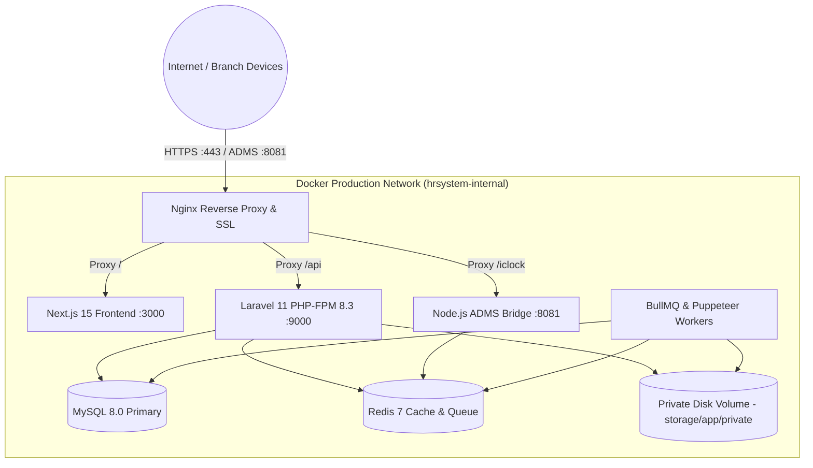

# Phase 11: Deployment, DevOps & Infrastructure Architecture
## Production Multi-Container Orchestration, Nginx Reverse Proxy & Backup Runbook

This document details the production deployment architecture, Docker multi-container topology, Nginx routing, PHP-FPM performance tuning, Redis memory configuration, and automated disaster recovery.

---

## 🏛️ Production Multi-Container Topology



---

## 🐳 Production `docker-compose.yml`

```yaml
version: '3.8'

networks:
  hrsystem-internal:
    driver: bridge

volumes:
  mysql_data:
  redis_data:
  private_storage:
  nextjs_cache:

services:
  # 1. Edge Reverse Proxy & SSL
  nginx:
    image: nginx:alpine
    container_name: hrsystem-nginx
    restart: always
    ports:
      - "80:80"
      - "443:443"
      - "8081:8081" # Biometric ADMS devices connect here
    volumes:
      - ./docker/nginx/nginx.conf:/etc/nginx/nginx.conf:ro
      - ./docker/ssl:/etc/nginx/ssl:ro
    depends_on:
      - frontend
      - backend
      - adms-bridge
    networks:
      - hrsystem-internal

  # 2. Primary Backend REST API (Laravel 11 / PHP 8.3)
  backend:
    build:
      context: ./backend
      dockerfile: Dockerfile
    container_name: hrsystem-backend
    restart: always
    environment:
      APP_ENV: production
      APP_DEBUG: "false"
      DB_CONNECTION: mysql
      DB_HOST: mysql
      DB_PORT: 3306
      DB_DATABASE: hrsystem_db
      DB_USERNAME: ${DB_USERNAME}
      DB_PASSWORD: ${DB_PASSWORD}
      REDIS_HOST: redis
      REDIS_PORT: 6379
    volumes:
      - private_storage:/var/www/html/storage/app/private
    depends_on:
      - mysql
      - redis
    networks:
      - hrsystem-internal

  # 3. Web Frontend (Next.js 15 Standalone)
  frontend:
    build:
      context: ./frontend
      dockerfile: Dockerfile
    container_name: hrsystem-frontend
    restart: always
    environment:
      NODE_ENV: production
      PORT: 3000
    networks:
      - hrsystem-internal

  # 4. Hardware Biometric Bridge (Node.js ADMS Listener)
  adms-bridge:
    build:
      context: ./bridge
      dockerfile: Dockerfile
    container_name: hrsystem-adms-bridge
    restart: always
    environment:
      BRIDGE_PORT: 8081
      REDIS_HOST: redis
      REDIS_PORT: 6379
    depends_on:
      - redis
    networks:
      - hrsystem-internal

  # 5. BullMQ Workers (PDF Generation & Punch Pairing)
  workers:
    build:
      context: ./workers
      dockerfile: Dockerfile
    container_name: hrsystem-workers
    restart: always
    environment:
      DB_HOST: mysql
      DB_DATABASE: hrsystem_db
      DB_USERNAME: ${DB_USERNAME}
      DB_PASSWORD: ${DB_PASSWORD}
      REDIS_HOST: redis
      REDIS_PORT: 6379
      LARAVEL_PRIVATE_STORAGE_PATH: /var/storage/private
    volumes:
      - private_storage:/var/storage/private
    depends_on:
      - mysql
      - redis
    networks:
      - hrsystem-internal

  # 6. MySQL 8.0 Database
  mysql:
    image: mysql:8.0
    container_name: hrsystem-mysql
    restart: always
    command: >
      --default-authentication-plugin=mysql_native_password
      --character-set-server=utf8mb4
      --collation-server=utf8mb4_0900_ai_ci
      --innodb-buffer-pool-size=4G
      --innodb-log-file-size=512M
      --innodb-flush-log-at-trx-commit=1
      --max-connections=500
    environment:
      MYSQL_DATABASE: hrsystem_db
      MYSQL_ROOT_PASSWORD: ${DB_ROOT_PASSWORD}
      MYSQL_USER: ${DB_USERNAME}
      MYSQL_PASSWORD: ${DB_PASSWORD}
    volumes:
      - mysql_data:/var/lib/mysql
    networks:
      - hrsystem-internal

  # 7. Redis 7 Cache & BullMQ Message Broker
  redis:
    image: redis:7-alpine
    container_name: hrsystem-redis
    restart: always
    command: redis-server --appendonly yes --maxmemory 2gb --maxmemory-policy noeviction
    volumes:
      - redis_data:/data
    networks:
      - hrsystem-internal
```

---

## 🔒 2. Production Nginx Reverse Proxy Configuration

```nginx
# /etc/nginx/nginx.conf

user nginx;
worker_processes auto;
error_log /var/log/nginx/error.log warn;
pid /var/run/nginx.pid;

events {
    worker_connections 2048;
}

http {
    include /etc/nginx/mime.types;
    default_type application/octet-stream;
    
    sendfile on;
    tcp_nopush on;
    tcp_nodelay on;
    keepalive_timeout 65;
    gzip on;
    gzip_types text/plain text/css application/json application/javascript text/xml;

    # 1. Main Application & API Server (HTTPS 443)
    server {
        listen 443 ssl http2;
        server_name *.hrsystem.com hrsystem.com;

        ssl_certificate /etc/nginx/ssl/live/hrsystem.com/fullchain.pem;
        ssl_certificate_key /etc/nginx/ssl/live/hrsystem.com/privkey.pem;

        # Laravel 11 REST API
        location /api/ {
            fastcgi_pass backend:9000;
            fastcgi_index index.php;
            include fastcgi_params;
            fastcgi_param SCRIPT_FILENAME /var/www/html/public/index.php;
            fastcgi_param PATH_INFO $fastcgi_path_info;
            fastcgi_read_timeout 180s;
        }

        # Next.js 15 Web Portal
        location / {
            proxy_pass http://frontend:3000;
            proxy_http_version 1.1;
            proxy_set_header Upgrade $http_upgrade;
            proxy_set_header Connection 'upgrade';
            proxy_set_header Host $host;
            proxy_cache_bypass $http_upgrade;
        }
    }

    # 2. Biometric ADMS Ingestion Listener (Port 8081)
    server {
        listen 8081;
        server_name _;

        # ZKTeco and Hikvision Push endpoint
        location /iclock/ {
            proxy_pass http://adms-bridge:8081;
            proxy_set_header Host $host;
            proxy_set_header X-Real-IP $remote_addr;
            proxy_read_timeout 60s;
        }

        location /api/hikvision/ {
            proxy_pass http://adms-bridge:8081;
            proxy_set_header Host $host;
            proxy_set_header X-Real-IP $remote_addr;
        }
    }
}
```

---

## 💾 3. Automated Backup & Disaster Recovery (DR)

### Backup Runbook:
1. **Automated Daily MySQL Dump:** Runs every night at 02:00 AM UTC.
2. **Binary Logging (PITR):** Point-In-Time Recovery enabled for up to 7 days, allowing restoration to the exact second before an accidental data truncation or error.
3. **Recovery Objectives:**
   - **RTO (Recovery Time Objective):** < 15 minutes to spin up replica in disaster scenario.
   - **RPO (Recovery Point Objective):** < 1 minute (guaranteed by continuous MySQL binary log replication).

```bash
#!/bin/bash
# scripts/daily_backup.sh
BACKUP_DATE=$(date +"%Y%m%d_%H%M%S")
BACKUP_DIR="/var/backups/hrsystem"
mkdir -p "$BACKUP_DIR"

# 1. Dump MySQL database with consistent snapshot
docker exec hrsystem-mysql mysqldump \
  --single-transaction \
  --quick \
  --routines \
  --triggers \
  -u root -p"${DB_ROOT_PASSWORD}" hrsystem_db \
  | gzip > "$BACKUP_DIR/db_backup_${BACKUP_DATE}.sql.gz"

# 2. Sync private document vault to remote secondary storage
aws s3 sync /var/www/html/storage/app/private s3://company-hr-disaster-recovery/vault/ --sse AES256

echo "✓ Backup completed at $(date)"
```

