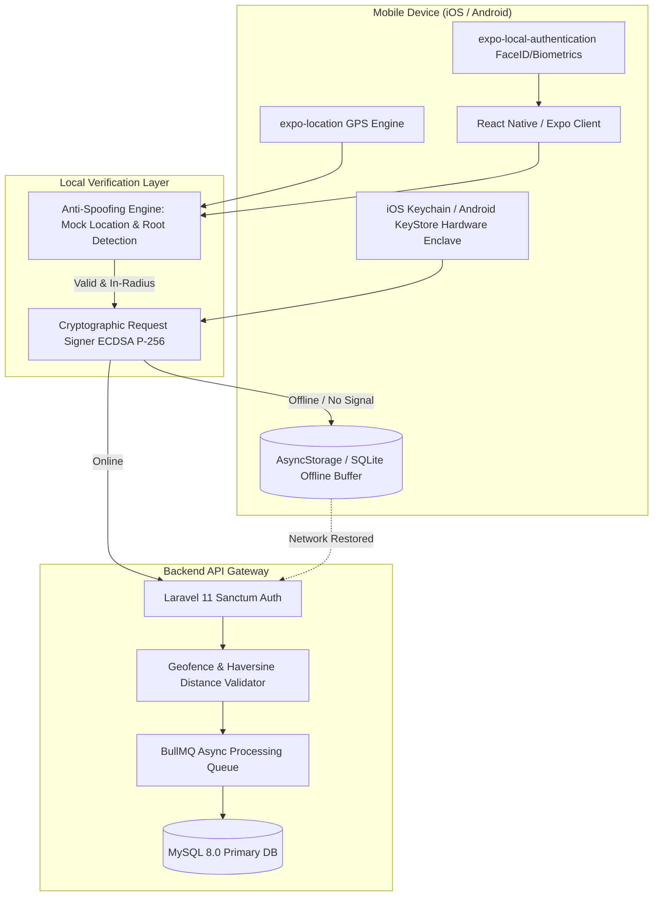
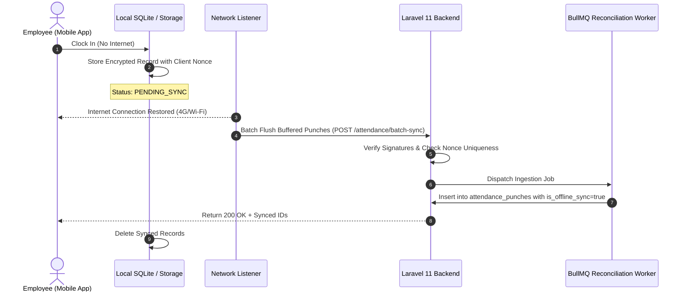

# Phase 12: Employee Self-Service (ESS), Mobile Architecture & Offline Sync Protocol
## React Native (Expo) & Web Portal Architecture, Cryptographic Biometrics & Anti-Spoofing

This document specifies the technical architecture for the Employee Self-Service (ESS) platform across both the Next.js web application and the React Native (Expo) cross-platform mobile application. It covers offline biometric attendance buffering, hardware secure enclave signing, anti-tampering heuristics, and employee request workflows.

---

## 📱 1. Architecture Topology & Mobile Interaction Flow



---

## 🔐 2. Cryptographic Device Binding & Biometric Key Signing

To prevent proxy clock-ins (buddy punching) and spoofed HTTP requests, the mobile app pairs each employee's device using public-key cryptography.

### 2.1 Device Enrollment Protocol (Hardware Enclave)
1. **Device Registration:**
   - On first login, the app requests the device's Secure Enclave (`iOS LocalAuthentication / Secure Enclave` or `Android KeyStore`) to generate an asymmetric keypair:
     - Algorithm: **ECDSA with curve P-256 (secp256r1)** and **SHA-256**.
     - Storage attribute: `kSecAttrAccessibleAfterFirstUnlockThisDeviceOnly` (cannot be backed up to iCloud/Google Cloud or transferred between devices).
2. **Public Key Registration:**
   - The device public key is transmitted to `POST /api/v1/auth/register-device` alongside a signed SMS/WhatsApp OTP token.
   - The Laravel backend stores `device_public_key`, `device_model`, `os_version`, and `device_uuid` in `employee_devices`.

### 2.2 Attendance Punch Payload & Digital Signature
When an employee punches from their mobile device, the payload is signed with the private key inside the hardware enclave:

```json
{
  "tenant_id": "9d3e8e24-7b19-4a92-8025-b4618e7e39a1",
  "employee_id": "9d3e8e25-1a22-4876-b611-3e54b67f1011",
  "punch_type": "CHECK_IN",
  "client_timestamp": "2026-11-05T08:58:32.412Z",
  "latitude": 24.7135517,
  "longitude": 46.6752957,
  "accuracy_meters": 4.2,
  "altitude_meters": 612.0,
  "wifi_bssid": "3c:37:86:14:f2:a0",
  "is_mock_location": false,
  "biometric_authenticated": true,
  "nonce": "7c8e9f01-3b4c-4e8a-9f5e-123456789abc",
  "signature": "MEQCIAx9dYp78Jq3B81gD4a0w..."
}
```

Backend verification logic:
```php
$publicKey = $employee->activeDevice->public_key;
$rawPayload = json_encode([
    'tenant_id' => $data['tenant_id'],
    'employee_id' => $data['employee_id'],
    'punch_type' => $data['punch_type'],
    'timestamp' => $data['client_timestamp'],
    'lat' => $data['latitude'],
    'lng' => $data['longitude'],
    'nonce' => $data['nonce']
]);

$verified = openssl_verify(
    $rawPayload,
    base64_decode($data['signature']),
    $publicKey,
    OPENSSL_ALGO_SHA256
);

if ($verified !== 1) {
    throw new SecurityException("Attendance punch signature verification failed.");
}
```

---

## 🛡️ 3. Anti-GPS Spoofing & Tamper Protection

Mobile location spoofing (using Fake GPS or Developer Mock Locations) is combated using a 4-tier defense:

| Layer | Technique | Mobile Check | Server-Side Validation |
| :--- | :--- | :--- | :--- |
| **Tier 1: Mock Location Flags** | `isFromMockProvider` / `mockLocation` | `Location.getProviderStatusAsync()` checks if mock location is active. | Rejects punch immediately if `is_mock_location == true`. |
| **Tier 2: Wi-Fi BSSID Whitelist** | Access Point MAC matching | Scans current Wi-Fi BSSID via `expo-network` / native bridge. | Compares BSSID against branch registered access points. |
| **Tier 3: GPS Accuracy Clamp** | Horizontal accuracy threshold | Discards fixes where `accuracy_meters > 35m`. | If accuracy > 50m, marks status as `FLAGGED_LOW_ACCURACY`. |
| **Tier 4: Impossible Travel Velocity** | Haversine velocity comparison | Compares previous punch location and timestamp. | If distance > 100km within 15 minutes, triggers fraud alert. |

---

## 🔄 4. Offline Attendance Punch Buffering & Reconciliation

When an employee works in a basement, remote desert oilfield, or offline warehouse with zero cell connectivity, punches must be buffered securely and synced when internet connectivity returns.



### 4.1 Anti-Replay Nonce Store
To prevent replay attacks when syncing offline buffers, every punch contains a UUIDv4 nonce. The backend records each processed nonce in Redis with a 30-day TTL:
```php
$nonceKey = "punch_nonce:{$tenantId}:{$nonce}";
if (Redis::exists($nonceKey)) {
    return response()->json(['error' => 'Duplicate punch replay detected'], 409);
}
Redis::setex($nonceKey, 2592000, 1); // 30 days
```

---

## 📑 5. Employee Self-Service (ESS) Request Lifecycle

The ESS module enables staff to initiate core HR requests without paper forms:

### 5.1 Salary Identification Certificate (شهادة تعريف بالراتب)
- **Features:**
  - Automated generation with Arabic/English bilingual layout.
  - Option to address to "To Whom It May Concern" (إلى من يهمه الأمر) or a specific commercial bank/embassy.
  - Cryptographic verification QR code embedding URL: `https://hrsystem.com/verify-doc/{uuid}`.
  - Dynamic display of Basic Salary, Housing Allowance, and Net Salary based on latest approved payroll run.

### 5.2 Expense Reimbursement & Travel Per-Diem (طلب استرداد مصاريف / بدل سفر)
- Multi-currency receipt upload (SAR, EGP, USD, EUR) with live exchange rate snapshot.
- Categories: Travel tickets, Hotel accommodation, Client entertainment, Field supplies.
- Financial clearance workflow: Direct Manager approval -> Finance Department audit -> Direct payout in next monthly payroll batch.

### 5.3 Salary Advance / Emergency Loan (سلفة على الراتب)
- Maximum limit enforced: Maximum 50% of 1 month's basic salary.
- Automated monthly installment deduction configured directly in employee's recurring deductions table.
- Automatic freeze if employee has pending disciplinary actions or is in probation period.

---

## 📊 6. Mobile Performance & Battery Optimization

- **Zero Continuous Background Tracking:** To respect privacy and battery life, the mobile app uses **Geofencing regions** (`startGeofencingAsync`) rather than continuous high-accuracy GPS polling.
- **Geofence Radius:** Defaults to 150 meters from the corporate branch centroid.
- **App Cold Start:** Under 1.2 seconds to clock-in screen.
- **Biometric Prompt:** Triggers natively via OS FaceID / Fingerprint dialog with localized prompt strings.
