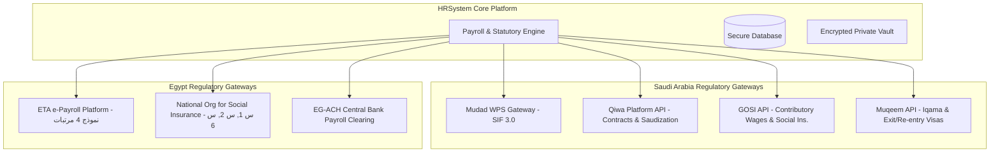

# Phase 13: Government Integrations & National Banking Specifications
## Saudi Arabia (Mudad, Qiwa, GOSI, Muqeem) & Egypt (ETA e-Payroll, Social Insurance, EG-ACH)

This document provides the technical integration specifications, API protocol definitions, and bank file standards required to achieve 100% regulatory compliance in both the Kingdom of Saudi Arabia (KSA) and the Arab Republic of Egypt (ARE).

---

## 🏛️ 1. Government Integrations Architecture Overview



---

## 🇸🇦 2. Saudi Arabia Statutory Integrations

### 2.1 Mudad (مدد) Wage Protection System (WPS) & SIF 3.0 Specification
All private-sector establishments in Saudi Arabia must upload a monthly Standard Interchange Format (SIF) file to Mudad within the statutory grace period following salary disbursement.

#### SIF Header Record Format (CSV Format - Fixed Width):
```
Record Type, Sponsor ID, Sponsor Bank Code, File Creation Date, File Creation Time, Reference Number, Number of Records, Total Salary
```
- Example:
  `1,7001234567,RIBL,20261105,093000,PAY202611001,148,854400.00`

#### SIF Employee Record Format:
```
Record Type, National ID/Iqama, Employee Name, Bank Code, IBAN, Basic Salary, Housing Allowance, Other Earnings, Deductions, Net Salary
```
- Example:
  `2,1098765432,Abdullah Saad Al-Otaibi,RJHI,SA0380000000608010167519,18000.00,4500.00,1500.00,2193.75,21806.25`

#### Validation Rules & Compliance Checks:
1. **Net Salary Tolerance:** Must exactly match `(Basic + Housing + Other) - Deductions`.
2. **Payment Window:** Must be disbursed within **3 days** of the defined monthly paydate (usually the 27th or 1st).
3. **Justification for Deductions:** Any deduction exceeding 50% of the gross wage will be rejected with error `ERR_DED_MAX_EXCEEDED` under Article 92 of the Saudi Labor Law.

---

### 2.2 Qiwa (قوى) Platform Integration
- **Contract Management:**
  - Automated sync of authenticated digital employment contracts (`Qiwa Contract API`).
  - Webhook listener for employee contract acceptance/rejection status.
- **Saudization & Nitaqat Tracking:**
  - Real-time calculation of Saudi national equivalent points (e.g., Special Needs citizens count as 4 points under Nitaqat formulas).
  - Instant alerts when an establishment's Saudization percentage risks slipping from High Green (أخضر مرتفع) to Yellow/Red.

---

### 2.3 GOSI (التأمينات الاجتماعية) Contributory Wage Sync
- **Annual Wage Updating (January Cycle):**
  - GOSI freezes contributory wage caps for the calendar year based on the registered wage as of January 1st.
  - Automatic generation of the GOSI bulk update file (`.txt` fixed format) containing Basic Wage + Housing Allowance capped between **1,500 SAR and 45,000 SAR**.
- **Accident & Occupational Hazards (أخطار مهنية):**
  - Statutory 2% occupational hazard contribution automatically calculated on both Saudi and non-Saudi employees.

---

### 2.4 Muqeem (مقيم) Visa & Resident Lifecycle
- Direct API sync to track:
  - Resident ID (Iqama - هوية مقيم) expiration dates.
  - Exit & Re-Entry Visa (تأشيرة خروج وعودة) validity windows.
  - Professional title harmonization against official Saudi Ministry of Human Resources profession lists.

---

## 🇪🇬 3. Egypt Statutory Integrations

### 3.1 Egyptian Tax Authority (ETA) Unified Payroll Tax Platform (منظومة توحيد أسس ومعايير ضريبة الأجور والمرتبات)
Starting 2023–2024, all Egyptian companies must integrate with the ETA e-Payroll system via REST API to transmit monthly salary slips and quarterly tax returns.

#### Technical Specifications:
- **Authentication:** OAuth 2.0 with mutual TLS (mTLS) and digital certificate from Egypt Trust / MCDR.
- **Payload Format:** JSON serialized according to ETA Schema Version 2.1.
- **Monthly Return (نموذج 4 مرتبات):**
  - Gross salary breakdown (Base, Variable, Travel per-diem, Production incentives).
  - Social Insurance insurable wage deductions.
  - Non-taxable personal exemption (20,000 EGP annually / 1,666.67 EGP monthly under Law 30 of 2023).
  - Martyrs & Disabled Persons Support Fund (صندوق تكريم الشهداء ومكافحة الإعاقة): 0.05% deduction on gross earnings.
  - Calculated progressive personal income tax (Brackets: 0%, 10%, 15%, 20%, 22.5%, 25%, 27.5%).

---

### 3.2 National Organization for Social Insurance (NOSI / الهيئة القومية للتأمين الاجتماعي)
Under Egypt Social Insurance Law No. 148 of 2019:
- **Form 1 (استمارة 1):** Employee registration on onboarding. Generated as a standardized PDF with 2D barcode for immediate social insurance office submission.
- **Form 2 (استمارة 2):** Annual January wage declaration for all active employees showing basic wage and total social insurance wage (capped between 2,000 and 12,600 EGP for 2024–2026).
- **Form 6 (استمارة 6):** Termination / Resignation clearance filed within 7 days of employee departure.

---

### 3.3 Egyptian Automated Clearing House (EG-ACH) Banking Standard
For monthly bank transfers in Egypt (e.g. National Bank of Egypt - NBE, Banque Misr, CIB, QNB):
- Standardized file structure (`ACH_PAYROLL_EGP.txt` / ISO 20022 `pain.001.001.03` format).
- Includes:
  - National ID (14 digits)
  - Egyptian Bank BIC / Swift Code
  - Egyptian IBAN (29 characters starting with `EG...`)
  - Net monthly salary in EGP
  - Corporate originating account number

---

## 🔒 4. Data Security & Sovereignty Compliance

1. **Saudi Cloud Computing Regulatory Framework (CCRF):**
   - In accordance with National Cybersecurity Authority (NCA) Class B controls, PII data for Saudi employees (Iqamas, National IDs, GOSI numbers, bank IBANs) is encrypted at rest using AES-256 and never leaves sovereign Saudi data centers without government authorization.
2. **Egypt Personal Data Protection Law (Law 151 of 2020):**
   - Strict segregation of Egyptian citizen employee records with tamper-evident audit logs.
   - Cross-border data transfer safeguards ensuring compliance with Egyptian Data Protection Centre (EDPC) guidelines.
